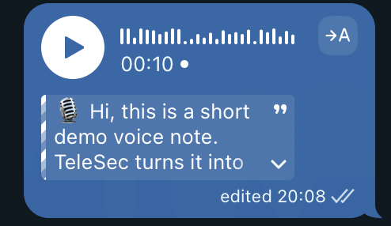
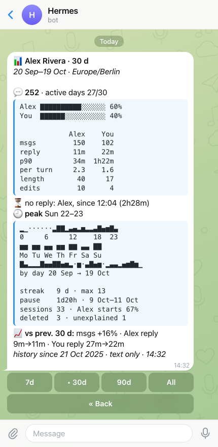
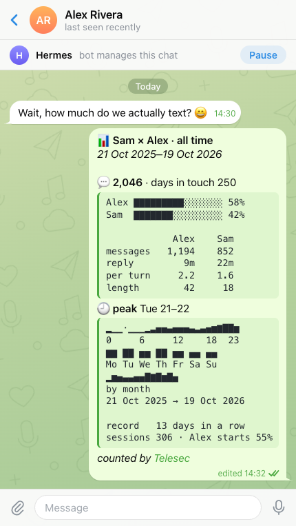

# Telesec

[](https://github.com/neoromantic/telesec/actions/workflows/ci.yml)
[](LICENSE)

**Telesec — Telegram Business secretary for [Hermes](https://github.com/NousResearch/hermes-agent).** Voice messages, round video notes, and conservatively recognized attached audio files become readable text without a full agent turn. Optional correspondence history preserves text, edits, and deletions for contact-based search.

[Product demonstration and setup](https://telesec.sergeybaus.com). Telesec is a community plugin and is not affiliated with Nous Research.


## Current module: voice transcription



1. A native Telegram handler intercepts Business `voice`, `video_note`, `audio`, and conservatively identified audio `document` updates before ordinary media processing; generic documents and video are consumed without transcription.
2. Requires a real Telegram Business connection and preserves its `business_connection_id`.
3. Returns `action: skip` so the ordinary auth/agent path does not process the media.
4. Downloads the media transiently and delegates speech recognition to Hermes's configured `transcribe_audio` backend. Attached files must have safe byte/duration metadata, are locally duration-checked when needed, and pass a short mono/16 kHz speech-presence probe before full transcription.
5. Optionally asks the host-owned `ctx.llm` facade for conservative proofreading or opt-in enrichment with ASR correction, filler cleanup, paragraphing, lists, and long-note titles.
6. Publishes the first structurally usable enriched candidate. Empty output or a catastrophic size change gets one feedback retry; raw STT is the last fallback when neither model result is usable.
7. For a short outgoing Business message, appends the transcript to the original voice/video-note caption as an expandable blockquote, retrying the same caption as plain text when Telegram rejects the new entity type.
8. Uses expandable Business-scoped replies for incoming, long, expired, or uneditable messages, with the equivalent plain-text retry.

Handled updates are identified from stable Telegram Business connection, chat, update/message, and relationship data, then suppressed in memory for 24 hours. A successful caption edit suppresses the separate transcript reply, so the chat never receives both forms. PTB `BadRequest` is treated as a definite Telegram-side rejection unless it is the recognized `message is not modified` or unsupported-entity case. Failed entity requests are not treated as delivered before their targeted plain-text retry, and ambiguous post-send transport/backend failures suppress the reply fallback unless remote state is verified. The voice pipeline never runs a separate model provider client and never needs its own credentials.

## Settings

Three switches cover all chats: transcription (on by default), history (off by default), and dossiers (off by default). One more row sets how long history is kept (forever by default). Change them in your private chat with the bot: send `/telesec`, or tap **⚙️ Settings** on any chat's [owner panel](#per-chat-transcription-modes).

```text
Telesec settings · all chats
One chat: Manage Bot in that chat.
Keep history: forever
Dossier model: ai-gateway / google/gemini-3.8-flash
Voice cleanup: gemini / gemini-3.8-flash
[• Transcribe] [Don't transcribe]
[Save history] [• Don't save]
[• Forever] [1 year] [90 days] [30 days]
[Keep dossiers] [• No dossiers]
```


Or from the terminal:

```bash
hermes telesec settings
hermes telesec settings --format json
hermes telesec settings set history on
hermes telesec settings set transcription off
hermes telesec settings set retention 90
hermes telesec settings set retention forever
```

A change applies to the next update; no restart is needed. To turn history or the dossier off for one chat, use that chat's [owner panel](#per-chat-history-and-dossier); `hermes telesec settings` also counts such chats. Turning dossiers on asks first and names the model that will receive chat text. Dossiers are built from history, so while history is off they are paused, and Settings says so. Settings speaks Russian when your Telegram app is set to Russian (`Настройки Telesec`).

The **Forever · 1 year · 90 days · 30 days** row sets how long saved history is kept, and the `Keep history:` line shows the value in effect. A shorter time asks first; a longer one applies at once. History is deleted a whole month at a time: once all of a month is older than the chosen time, the next cleanup deletes it, so the current month always stays. Cleanup runs when the gateway starts, when a `hermes` command loads Telesec (such as `hermes telesec settings`), and at most hourly while Business messages arrive. The row stays while history is off, because cleanup keeps running. In the terminal, `hermes telesec settings set retention N` sets any number of days, and Settings shows such a value as its own button (for example `• 45 days`) until you pick another. See [retention and removal](docs/HISTORY.md#retention-and-removal).

The last lines show the model that writes dossiers (`your main model` when its task follows the main model) and the model that cleans up voice transcripts (or `off`), as configured. They are read-only: choose the dossier model with `hermes model` → Telesec dossiers ([dossier model](#dossier-model)) and the cleanup model in the [configuration](#configuration). A warning line follows the dossier model when its `extra_body` still has the gateway-only `providerOptions` on another provider.

Only an owner of every Business connection the bot knows about can change the switches and retention; another verified owner sees them read-only. Anyone else's `/telesec`, `/telesec` with more text after it, and `/telesec` in a group go to Hermes as usual, where the `/telesec` command only says that Telesec settings are for the Business account owner. Settings are never posted into a Business chat, and a `/telesec` typed in a Business chat never gets an answer there.

Transcription, history, and retention are stored in `$HERMES_HOME/data/telesec/settings.json`, dossiers in `$HERMES_HOME/data/telesec/dossiers/settings.json`, with `0600` permissions and atomic writes. The files hold only the switches, the retention in days (`0` is forever), and when and how (`telegram`, `cli`, or `migration`) each was set. If `settings.json` becomes corrupt or unreadable, the gateway keeps the switches it last read (transcription on and history off if it never read any) and logs it; Telegram shows an error instead of overwriting it, and only `hermes telesec settings set` backs it up and starts a new one.

Hermes core has more commands than Telegram's "/" menu holds, so `/telesec` is not in the menu by default. To add it, set this in the Hermes config:

```yaml
platforms:
  telegram:
    extra:
      command_menu:
        priority: [telesec]
```

**Upgrade from 0.11.0 or earlier.** `TELESEC_DISABLE`, `TELESEC_HISTORY_ENABLE`, and the Desktop `history_enable` setting are no longer read. On the first start each value that differs from the default (transcription off, history on) is stored once in Settings, and the gateway log says so. The variable still wins over the Desktop setting, as before, so a `TELESEC_HISTORY_ENABLE=0` that overrides a Desktop `history_enable` is stored as history off. A stored choice is never overwritten. A CLI run without the gateway's environment can store only the Desktop setting's value. After that a leftover variable only causes one log warning per start; remove it once you no longer plan to go back to 0.11.0 or older, which read only the variables and the Desktop setting. No manual step is needed: a gateway with history on keeps it on, transcription stays as it was, and dossiers keep their 0.11.0 switch.

**Upgrade from 0.12.** `TELESEC_HISTORY_RETENTION_DAYS` is no longer read. On the first start a value other than `0` is stored once as the retention in Settings (`via migration`), and the gateway log says so; a stored choice is never overwritten. A `hermes telesec settings set` that creates a new `settings.json` or replaces a corrupt one stores retention as forever, so the variable is not moved in after that; choose the time in Settings. Remove the variable after the upgrade: while it is set, each start logs a warning, and if `settings.json` is deleted, the next start moves it in again. Telesec 0.12 ignores the stored retention, so after going back to it the variable applies again.

## Per-chat transcription modes

Each Business chat has one mode that covers voice messages, round videos, and attached audio:

| Mode | Transcribes |
|---|---|
| `both` (default) | Your messages and the contact's. |
| `own` | Only your own messages. |
| `peer` | Only the contact's messages. |
| `off` | Nothing in this chat. |

The main control is the owner panel. In any chat where the Business bot is connected, Telegram shows you, the account owner, a "Manage Bot" button. It opens your private chat with the bot, and the bot answers there with that chat's panel:

```text
Owner panel: Casey (@casey) · chat 991
Transcription: off
[both] [own] [peer] [• off]
[Reset to default]
[• Save history] [Don't save]
[• Keep dossier] [No dossier]
[📊 Stats] [Dossier]
[⚙️ Settings] [Refresh]
```


Tap a mode to set it, or Reset to return to the default; the panel message updates in place. The history and dossier rows below it work the same way for this chat ([per-chat history and dossier](#per-chat-history-and-dossier)). The header always ends with `chat <id>`, so when you reply to a panel message to ask the agent about that chat, the reply names the chat. The panel speaks Russian when your Telegram app is set to Russian (`Панель владельца`, `Расшифровка: выкл`, mode buttons `все`, `мои`, `собеседника`, `выкл`) and English otherwise; modes are still stored as `both`, `own`, `peer`, and `off`. Only you see the panel: it lives in your private chat with the bot and the contact sees nothing. Only a verified owner gets the panel. Anyone else's `/start bizChat…` is treated as an ordinary message, and a panel button pressed by anyone else gets a short "Not allowed" alert.

To confirm you are the owner, the bot asks Telegram who owns the Business connections it knows: ones Telegram reported connecting since the gateway started, ones with any Business message since the gateway started (both kept in memory only), ones whose owner the modes file records, ones it already looked up the owner for, and the connections in the history catalog (read even while history is off). So any message in the chat, yours or the contact's, is enough; no command is needed. While the gateway knows no Business connection at all, Manage Bot answers with a hint to send any message in that chat and tap Manage Bot again. Once it knows one, the `/start` of someone whose connection it does not know yet is handled as an ordinary message. The panel reads and shows per-chat data (such as stats) only for a connection that history lists for the chat or that a message was seen on; otherwise a section says the connection is not known yet. Mode buttons work for the chat right away, even after a restart and before the contact writes again; modes are stored per owner, so your change never touches another owner's chat with the same contact. With transcription off in [Settings](#settings), the panel says so and shows no mode buttons. Other features add their own panel sections, such as the chat's [contact dossier](docs/DOSSIERS.md#in-telegram).

Panel taps and all Business message updates stop update propagation before Hermes' group-99 dispatch counter, so after a quiet period the core "Telegram ingress is healthy but deaf" warning can report a stale gap. The gap resets on reconnect and needs no action.

There are two in-chat commands, both only for you, and the contact sees what each one posts: [`/dossier`](#contact-dossiers-opt-in) posts a fresh summary of the chat, and `/stats` turns into a stats card ([details](docs/STATS.md#in-a-business-chat-stats)). `/stats` is a chat command because its point is to share the numbers with the contact. Everything only for you, including the full stats, stays in the owner panel. Any other text you type in a Business chat, including `/transcribe`, is ordinary text that the contact sees.

The same modes are available from the CLI:

```bash
hermes telesec mode list
hermes telesec mode get 991
hermes telesec mode set @alice off
hermes telesec mode reset 991
hermes telesec mode get 991 --format json
```

`mode list` and `mode get` take `--format json`. Each chat has `mode` (the stored mode, or `null`), `effective_mode` (what the next voice note gets), and `source`: `stored`, `default`, or `disabled` when transcription is off in [Settings](#settings).

The agent knows these commands too. On Hermes with plugin system prompt sections, the plugin adds a short neutral reference to each new session: the `mode`, `chat`, `stats`, and `settings` commands with `--format json`, the `history` and `dossiers` skills, the rule never to quote a private dossier, owner note, or persona into a Business chat, and the rule that a reply to a panel message is about the panel's `chat <id>`. So you can reply to a panel message with a question like "how much did we talk this month?".

A chat is a numeric `chat_id` or, with history enabled, a `@username` or name resolved through the history contact catalog. Ambiguous names need the numeric `chat_id` or `--connection`. Without `--owner USER_ID`, a chat on a Business connection whose owner the modes file records belongs to that owner. The connection comes from `--connection`, from the history entry of a chat named by `@username` or name, or, for a numeric `chat_id`, from history when exactly one connection lists that chat. Otherwise the CLI uses the only known owner, where an owner is known once the modes file stores a mode for them or records them as a connection's owner. It does so only when history lists at most one Business connection, or only connections recorded for that owner, since a connection with no recorded owner may belong to another Business account; in every other case pass `--owner`. History does not record owner ids, so on a fresh install the first `set` or `reset` needs `--owner USER_ID`, or one mode change in the owner panel first (Refresh records nothing); `list` and `get` report the default. `set` warns about an `--owner` it has not seen before. If the modes file cannot be read or is corrupt, the CLI reports an error instead of the default; only `set` or `reset` with `--owner` backs a corrupt file up and starts a new one.

Modes are stored per (owner, chat) in `$HERMES_HOME/data/telesec/transcription-modes.json` with `0600` permissions and atomic writes. Each entry holds only the mode, when and how (`chat` or `cli`; a panel change is stored as `chat` so 0.9.0 can still read it) it was set, and a display label for the chat. The file also records which owner each Business connection belongs to: a panel change records it when the panel knows the chat's connection (from history or a message seen since the gateway started), and so does the gateway when it looks up the owner for media in a chat with a non-default mode. The gateway's own lookup never records a connection whose chats all use the default, and a recorded connection stays recorded after its chats return to the default. Telegram's report that the bot was connected is never recorded, since any Business account can connect the bot. It never holds message text or transcripts. The gateway re-reads the file when it changes, so a CLI change applies to the next message without a restart.

The mode is checked once, before any download, speech recognition, or cleanup. A skipped note is still consumed silently: nothing is posted and the ordinary Hermes path does not see it. Logs record the decision and its reason, never content. When something is uncertain the plugin errs toward transcribing:

- A missing modes file, or an empty one (zero bytes or only whitespace), means every chat uses `both`. If the file becomes corrupt or cannot be read, the gateway keeps the modes it last read successfully (`both` everywhere if it never read any) and logs it. A panel change never overwrites a corrupt file and shows an error instead, while the panel still shows the mode the gateway is applying. While the file is corrupt or unreadable, the gateway also stops recording connection owners. Only `set` or `reset` with `--owner` from the CLI backs a corrupt file up and starts a new one.
- Under `own` or `peer`, a message whose direction cannot be determined is transcribed as usual.
- If the Business owner lookup fails, the plugin uses the owner it last recorded for that Business connection, both to pick the mode (so `off` stays off) and to tell own from peer messages under `own`/`peer`. A connection with no recorded owner falls back to transcribing, so one owner's mode never applies to another owner's chat with the same contact.

## Per-chat history and dossier

The same owner panel turns history and the dossier on or off for one chat, in the same style as transcription modes: "•" marks the value in effect.

| Row | Choices | Default |
|---|---|---|
| History | **Save history**, **Don't save** | Save history |
| Dossier | **Keep dossier**, **No dossier** | Keep dossier |

- **Don't save** stops history for this chat: new messages, edits, and deletions are not recorded. The chat's dossier pauses too, because dossiers are built from history.
- **No dossier** keeps history but skips the chat's dossier: the worker leaves it out of contact and persona updates, a running Refresh stops, and `/dossier` in the chat posts nothing (the bot tells you why in your private chat with it). The stored dossier stays as it was and you can still read it in the Dossier section, without Refresh.
- **🗑 Erase saved history** shows under the history row, or under the `History: off in Settings` line, when history holds messages from the chat and the chat saves nothing now: it is set to Don't save, the [old server scope](#moving-from-the-history-environment-variables) keeps it out, or history is off in Settings. It asks first, in the same message: `Erase 12 saved messages from this chat? Its dossier is deleted too. This cannot be undone.` **Erase** stops a running dossier refresh, deletes every saved message of this chat on your Business connection and the chat's entry in the contact list, and then its dossier. Stats then show no history for the chat, and the chat keeps its setting. Erased history does not come back by itself: to bring it back, turn the chat on (**Save history**) and run [`history import`](docs/HISTORY.md#import-past-messages) again. The button refuses while the chat saves history (`Choose Don't save for this chat first`) or while chat settings can't be read (`Chat settings can't be read; try again later`), so an old or repeated tap erases nothing. It never touches another owner's chat with the same contact.


In Russian the rows read «Сохранять историю» / «Не сохранять», «🗑 Стереть сохранённую историю», and «Вести досье» / «Не вести». A row that cannot apply is hidden, and a short line says why: `History: off in Settings` (history is off for all chats), `Dossier: off in Settings`, or `Dossier: needs history` (this chat saves no history). A chat the [old server scope](#moving-from-the-history-environment-variables) keeps out shows **Don't save** with "•" and the line `History: off by the old server scope` («История: выключена старой настройкой сервера»); **Save history** turns it on. A group chat has no dossier row, since dossiers cover private chats only. Reset to default stays transcription-only: on is the default for history and the dossier and is not stored (except history turned on over the old server scope), so the on button already clears the setting.

**Off is not delete.** History already saved stays until you erase it (above, or `hermes telesec history forget` below), and retention and the size cap still prune it ([removal](docs/HISTORY.md#retention-and-removal)). Edits and deletions of older messages that arrive while the chat is paused are not recorded, and turning history back on leaves a gap. A paused dossier stays frozen; `hermes telesec dossier forget` deletes it. History keeps recording under No dossier, so Keep dossier later catches up and sends what was written meanwhile to the model. The persona leaves a paused chat out of its next rebuild; only erasing or forgetting the chat resets it at once.

From the terminal:

```bash
hermes telesec chat list
hermes telesec chat get 991
hermes telesec chat set 991 --history off
hermes telesec chat set @alice --dossier off
hermes telesec chat set 991 --history on --dossier on
hermes telesec chat get 991 --format json
hermes telesec chat scope
hermes telesec chat scope clear --yes
hermes telesec history forget --chat 991
hermes telesec history forget --chat 991 --yes
```

`chat` uses the same chat selectors and owner rules as [`mode`](#per-chat-transcription-modes) (`--owner`, `--connection`). When those rules find no owner, it uses the one owner who has a setting for that chat. A numeric chat id is stored as Telegram sends it, so `0991` means chat `991`. `get` shows the stored values and the values in effect, with the reason when something is off elsewhere (`scope`, `settings`, `needs_history`, `no_history`, `private_only`, or `unreadable`). In JSON, `chat list` and `chat get` report `effective_history` and `effective_dossier`, and so do `mode list` and `mode get`. They use each chat's type from history, so a list shows the same values as the panel. When no owner can be found, a chat that some owner paused reads as off. A change applies to the next update; no restart is needed.

`history forget` erases one chat's saved history and its dossier, like the panel's Erase button. It takes the same chat selectors as `history show` (`--chat`, `--contact`, `--connection`). Without `--yes` it only prints what it would erase and exits with code 1. It also works while the chat still saves history, and then says that new messages are saved again. `hermes telesec history forget --all --yes` erases all saved history and every dossier, including the owner persona; Telegram has no button for that. A running gateway notices the erase the next time it reads the chat; no restart is needed.

The settings are stored per (owner, chat) in `$HERMES_HOME/data/telesec/chat-settings.json` with `0600` permissions and atomic writes. Only "off" values are stored, and "on" for a chat's history turned on over the old server scope, with when and how (`chat` or `cli`) they were set; no message text and no names. The old server scope rule, if any, is stored there too, under `legacy_scope`. Your setting covers only your own chat with the contact, never another owner's. A panel change also records the chat's connection owner in the modes file, so history can check the setting without asking Telegram.

The checks fail closed. If one owner paused a chat id and the owner of another connection with the same chat id cannot be found, that connection's history for the chat is skipped until Telegram answers (this only happens when several Business accounts use one bot). If `chat-settings.json` becomes corrupt or unreadable, the gateway keeps the values it last read; if it never read any, history and dossiers pause for every chat, the log warns once, and the panel says `Chat settings can't be read; history and dossiers are paused.` Telegram never overwrites a corrupt file and shows an error instead; `hermes telesec chat set <chat> ... --owner ID` backs it up and starts a new one. The new file keeps the [old server scope rule](#moving-from-the-history-environment-variables) from the damaged one when that part can still be read, or stores it again from the `TELESEC_HISTORY_*` variables when they are set. Otherwise the command and the log say the rule was lost with the backup, and the chats it kept out start saving history.

Telesec 0.11.0 and older do not read `chat-settings.json`: after a downgrade, Don't save and No dossier stop applying and those chats are recorded again.

### Moving from the history environment variables

Telesec 0.13 and older chose which chats history records with `TELESEC_HISTORY_CONNECTIONS`, `TELESEC_HISTORY_CHATS`, and `TELESEC_HISTORY_CHAT_TYPES`. Since 0.14 history is set per chat in Telegram, and group chats are never recorded.

On the first start with any of them set, the plugin keeps the old filter as a stored rule: it saves the filter as 0.13 and older read it under `legacy_scope` in `chat-settings.json` and records that it ran. The rule still works per connection and chat, as before: a chat it keeps out saves no history and its dossier pauses, and that holds for a chat that never wrote to you before too. A value that matched nothing before, such as a misspelled chat type, still matches nothing. An empty variable is no filter, as before, so it stores nothing. Until the rule is stored, for example while `chat-settings.json` can't be written, the variables keep applying, and the next start tries again.

While the variables stay set, they apply too: a chat is kept out when the stored rule or the variables keep it out. Telesec 0.13 and older read only the variables, so keep them set while you may go back to 0.13 or older, and remove them from the profile's environment after that. Going back can also undo **Save history** for a chat the rule keeps out: when you change any setting of that chat in 0.13 and no "off" is left, 0.13 deletes the chat's entry, so the chat follows the variables again.

- In a chat's panel, a chat the rule keeps out on every connection it records through shows **Don't save** with "•" and the line `History: off by the old server scope`. **Save history** turns it on, and so does `hermes telesec chat set <chat> --history on`: the chat is then stored with history on, which overrides the rule and the variables.
- `hermes telesec chat scope` shows the stored rule and the variables in effect, with counts only. `chat list`, `chat get`, and `hermes telesec settings` say when they apply.
- `hermes telesec chat scope clear --yes` drops the stored rule. Chats it kept out start saving history with their next message, except chats set to Don't save and chats the variables keep out while they are set. A later start never stores the variables as the rule again. Without `--yes` it only explains and exits with code 1.

A filter that kept no private chat out stores no rule. The gateway log says what was stored, with counts only. Each later start logs one warning for every variable still set.

## Correspondence history

Turn history on in [Settings](#settings) (**Save history**), or from the terminal; no restart is needed:

```bash
hermes telesec settings set history on
```

History then records text in private Business chats. To leave one chat out, tap **Don't save** in its [owner panel](#per-chat-history-and-dossier) or run `hermes telesec chat set 991 --history off`. Then search by contact:

```bash
hermes telesec history contacts --search alice --limit 20
hermes telesec history show --contact @alice --since 7d --limit 100
hermes telesec history search --contact @alice --text estimate --since 30d --limit 100
hermes telesec history deletions --status unexplained --limit 20
```

History captures new text messages, edits, and deletions as Telegram delivers them. It preserves deleted text and distinguishes likely corrections, duplicates, unexplained deletions, and missing originals. It does not fetch old conversations, but you can import one chat's earlier messages from a Telegram Desktop export with `hermes telesec history import result.json --chat 991` ([import past messages](docs/HISTORY.md#import-past-messages)). Contact names and observed aliases are searchable; ambiguous names require an explicit choice.

Canonical storage is profile-local JSONL with a rebuildable contact catalog. Capture and search require no LLM. Media and captions are excluded from history in this version. [History configuration, retention, and CLI](docs/HISTORY.md).

## Correspondence stats

`stats` counts, per contact, text messages received and sent, active days, conversation sessions, latest activity, and deletions over retained history. It also measures the conversation: each side's share, turns, reply times (median and p90), who is waiting for a reply, message length, edits, busy hours and weekdays, activity over time, streaks, the longest silence, and a comparison with the previous period:

```bash
hermes telesec stats --since 30d
hermes telesec stats --contact @alice --since 2026-10-01 --tz Europe/Moscow
hermes telesec stats --contact @alice --format json
```

Messages are placed by Telegram send time, in the Hermes time zone or UTC. Only text messages are counted. The report needs no LLM, stores nothing new, and never prints message text; it reads text only to count its characters. [Counting rules, options, and a synthetic example](docs/STATS.md).

A compact view of the same stats for one chat is in Telegram, in Russian or English: tap **Manage Bot** in a Business chat, then **📊 Stats** in your private chat with the bot. It is never posted into the Business chat. It is a Telegram rich message: one balance bar (the contact 🟦, you 🟩), one table with a column for each side, emoji heat maps of when you talk, a few tiles, and a short footer. [Owner panel stats](docs/STATS.md#in-telegram-owner-panel).



It is a real Telegram screenshot of the view over fictional history ([in Russian](docs/images/stats-panel-ru@2x.png)).

To share stats with the contact, type `/stats` (all history) or `/stats 7d`, `30d`, or `90d` in the Business chat. Only the owner can. The bot edits the command into a short rich card for both of you: messages, each side's share, reply times, message length, when you talk, the longest streak, and sessions. The contact sees the card. It never shows deletions, edits, who is waiting, p90, missing history, or message text, and the command and card are never kept in history or counted. [In-chat `/stats`](docs/STATS.md#in-a-business-chat-stats).



## Contact dossiers (opt-in)

With history enabled, turn dossiers on in [Settings](#settings) (**Keep dossiers**, with a confirmation; offered only to an owner of every Business connection the bot knows about) or with `hermes telesec settings set dossiers on` (`hermes telesec dossier enable` still works); no restart is needed. A gateway-only background worker then keeps one short document for every private Business contact (tap **No dossier** in a chat's [owner panel](#per-chat-history-and-dossier) to skip one), plus one owner writing persona. A dossier is written for you to read: who the contact is, what you agreed, dates and amounts, open questions, and how to work with them. A few minutes after a chat goes quiet, the model rewrites the document with what changed: new messages, edits, and deletions. It keeps the previous version, so you can see the last change.

To correct a dossier, add to its owner note. The note is your own truth: the model follows it, including a request to leave something out, and never copies it into the document. A changed note rewrites the dossier on the next cycle. `--append` adds a paragraph to the note; `--text` replaces the whole note, and for a note converted from an older version, or one over 500 characters, it needs `--replace` ([owner note](docs/DOSSIERS.md#owner-note)).

```bash
hermes telesec dossier list
hermes telesec dossier show --contact @alice
hermes telesec dossier note --contact @alice --append "The contract is in my name, not my wife's. We don't discuss discounts."
hermes telesec dossier run --contact @alice
hermes telesec dossier show --contact @alice --previous
```

In Telegram, the panel's **Dossier** section shows the chat's dossier as a rich message in your app's language (Russian or English): the document, your note marked as not posted, and one status line, with **Refresh** and **My persona** (the owner persona) buttons. The on/off switch is in Settings.

Sending exactly `/dossier` in a private Business chat, as the owner, deletes the command and posts a fresh summary of the chat, titled "Summary of our chat" («Краткое содержание переписки»). It is written at that moment from the chat's live messages only: never from the private dossier, your note, the persona, or another chat, and never from deleted messages or the text before an edit Telesec recorded (an edit it never saw, such as one made while history was off, leaves the older text in). If a message is deleted or edited while the summary is written, nothing is posted. Telegram allows the post only if the contact wrote in the last 24 hours; any message counts, including voice, photos, stickers, and files. Telesec refuses at once only when it knows the contact has not written for 24 hours; otherwise it tries, and Telegram's refusal gives the same reason. Unlike the owner panel, `/dossier` is deliberately visible to the contact: its purpose is to share the summary with them. When nothing is posted, the bot tells you why in your private chat with it instead ([`/dossier` in a chat](docs/DOSSIERS.md#dossier-in-a-chat)).

Screenshots of the Dossier screen and of a `/dossier` summary, over a fictional contact, will be added here.

Enabling dossiers sends private chat text to the [dossier model](#dossier-model): by default Vercel AI Gateway, which passes it to Google with zero data retention; history capture alone never does. Telesec never posts a dossier, note, or persona into a chat; `/dossier` posts a new summary of the chat's own messages, and the `/stats` card the contact also sees has counts and times only. [Dossiers, Telegram views, privacy, and a synthetic example](docs/DOSSIERS.md).

## Planned assistant

The first layer is implemented: opt-in [contact dossiers and an owner persona](docs/DOSSIERS.md) keep short, readable context from history that you correct with a note. Contextual reply drafts with **Send / Edit / Discard**, plus explicitly enabled per-chat automatic replies with pause and human handover, are planned. Drafts and automatic replies are requirements, not runtime capabilities yet.

See the [roadmap](docs/ROADMAP.md) and [assistant design](docs/ASSISTANT.md).

## Requirements

- Hermes Agent 0.21.6 or newer with `ctx.register_telegram_handler`, CLI/skill registration, `pre_gateway_dispatch`, `ctx.llm`, and plugin model tasks (`ctx.register_auxiliary_task`, used by dossiers). Catalog validation targets Hermes 0.22.2 and PTB 22.8. [Compatibility evidence](docs/VERIFY.md).
- Python 3.11 or newer.
- A configured Telegram gateway with a Telegram Business connection.
- A working Hermes STT provider. Configure it with `hermes setup` or the [`stt` settings](https://hermes-agent.nousresearch.com/docs/user-guide/configuration).
- `ffprobe` and `ffmpeg` on `PATH` for attached-audio duration verification, prefix extraction, and normalization. Voice messages and video notes do not use these gates.

Business voice messages, round videos, and audio are transcribed for every contact, whether or not they are in the ordinary DM allowlist; per-chat modes and [Settings](#settings) decide what is transcribed. No variable is needed.

The plugin registers native Telegram handlers in group `-100`, before ordinary Hermes handlers. After history capture and transcription routing, every `business_message`, `edited_business_message`, and `deleted_business_messages` update is consumed with `ApplicationHandlerStop`. Ordinary Business text from either the owner or a contact never becomes an agent turn, even with history or transcription disabled or after a history-write failure. Normal bot DMs, including the owner panel, keep their existing routing. Transcribing a contact's Business media does not authorize their ordinary bot messages.

Owners who deliberately want unhandled Business updates to continue into Hermes can set `TELESEC_AGENT_ENABLE=1` in the active profile's `.env` and restart the gateway. The ordinary core auth/agent rules then apply; handled media and owner controls remain consumed.

History has its own switch in [Settings](#settings) and records eligible Business text updates independently of the ordinary DM allowlist. Telegram's selected Business-chat scope, a chat's Don't save, and the [old server scope](#moving-from-the-history-environment-variables) rule, if one is stored, determine what is captured.

## Upgrade from 0.9.x

The runtime ID and catalog key are now `telesec`; the repository is `neoromantic/telesec`. GitHub redirects old repository URLs.

Hermes keys installation directories by plugin name. Stop the gateway and run the upgrade script from a checkout of this version with the gateway's `HERMES_HOME` and Python environment:

```bash
bash scripts/upgrade-telesec.sh
hermes gateway restart
```

The script migrates data and configuration before removing the old installation, then runs `hermes plugins remove telegram-business-voice-transcriber` and `hermes plugins install neoromantic/telesec --enable --yes-deps`. The explicit dependency consent makes the script work non-interactively. First startup also performs the same idempotent migration: `data/telegram-business`, the old plugin cache and plugin state directories, `plugins.entries.telegram-business-voice-transcriber`, and enabled/disabled lists move to `telesec`. History, the contact catalog, transcription modes, and dossiers retain their contents; files remain private (`0600`). A conflicting destination is preserved and reported rather than overwritten. Keep the gateway stopped while resolving a conflict.

For 0.10.x, `hermes telegram-business` remains a deprecated CLI alias. Old `HERMES_TELEGRAM_BUSINESS_*` and `TG_BUSINESS_*` variables are accepted at startup with one deprecation warning; `TELESEC_*` values take precedence. Update your profile environment or systemd drop-ins to the names below. These aliases are removed in the next release.

## Install

```bash
hermes plugins install neoromantic/telesec --enable
hermes gateway restart
```

Inspect the installation:

```bash
hermes plugins list --user
```

Plugins are profile-scoped. Set `HERMES_HOME` or use the appropriate Hermes profile before installing when the gateway does not use the default profile.

## Update and remove

```bash
hermes plugins update telesec
hermes gateway restart
```

```bash
hermes plugins remove telesec
hermes gateway restart
```

`hermes plugins update` uses the Git remote retained by the installer. Both the old redirected source URL and the canonical repository URL remain supported; do not copy the directory manually if you want supported updates. Hermes core updates and this plugin's updates are independent: the installed plugin persists across a core update, while the command above advances the plugin itself.

Removing the plugin leaves its data under `$HERMES_HOME/data/telesec/`: history, dossiers, transcription modes, and settings. `hermes telesec history forget --all --yes` erases all history and every dossier while the plugin is installed. To erase everything, stop the gateway, remove that directory and any backups or exports you own, then restart. Remove the plugin's environment settings from the active profile too.

## Configuration

All plugin variables are optional. Hermes Desktop's plugin settings form exposes `cleanup_style` and `agent_enable`. They are read through `ctx.get_config` under `plugins.entries.telesec.settings`; environment variables override the form. Settings are re-read when used. Restart the gateway after changing environment variables or these settings. Transcription, history, dossiers, and history retention have no variable or Desktop setting: they are set in [Settings](#settings) (`/telesec` or `hermes telesec settings set`), with no restart. On upgrade, an old `TELESEC_DISABLE`, `TELESEC_HISTORY_ENABLE`, Desktop `history_enable`, `TELESEC_DOSSIER_ENABLE`, Desktop `dossier_enable`, or `TELESEC_HISTORY_RETENTION_DAYS` value is moved into Settings once and then ignored.

```yaml
plugins:
  entries:
    telesec:
      settings:
        cleanup_style: conservative
        agent_enable: false
```

See the [Hermes plugin settings API](https://hermes-agent.nousresearch.com/docs/developer-guide/plugins#store-settings-and-runtime-state).

| Variable | Default | Meaning |
|---|---:|---|
| `TELESEC_AGENT_ENABLE` | false | Allow unhandled Business updates into the ordinary Hermes auth/agent path. By default all Business message updates are consumed after history capture and transcription routing. |
| `TELESEC_SEND_ERRORS` | false | Reply with a short STT error notice. |
| `TELESEC_CLEANUP_DISABLE` | false | Skip LLM cleanup and post raw STT text. |
| `TELESEC_CLEANUP_PROVIDER` | `gemini` | Host provider requested for cleanup. |
| `TELESEC_CLEANUP_MODEL` | `gemini-3.8-flash` | Host model requested for cleanup. |
| `TELESEC_CLEANUP_STYLE` | `conservative` | Use `enriched` for filler removal, active editing, paragraph/list structure, and long-note titles. |
| `TELESEC_CLEANUP_TIMEOUT` | `45` | Cleanup timeout in seconds. |
| `TELESEC_CLEANUP_MIN_CHARS` | `81` | Minimum transcript length for cleanup. |
| `TELESEC_CLEANUP_MIN_WORDS` | `1` | Minimum word count for cleanup. |
| `TELESEC_TITLE_MIN_CHARS` | `700` | Add an enriched-mode title at this transcript length. |
| `TELESEC_TITLE_MIN_WORDS` | `120` | Add an enriched-mode title at this word count. |
| `TELESEC_AUDIO_FILE_MAX_DURATION_SECONDS` | `300` | Maximum attached-audio duration; bounded to 1–3600 seconds. |
| `TELESEC_AUDIO_FILE_MAX_BYTES` | `20971520` | Maximum attached-audio size; bounded to 1024–104857600 bytes. Missing or zero metadata is rejected before download. |
| `TELESEC_AUDIO_FILE_PROBE_SECONDS` | `10` | Prefix duration extracted locally for speech probing; bounded to 1–60 seconds and capped at the configured maximum duration. |
| `TELESEC_AUDIO_FILE_MIN_WORDS` | `3` | Minimum lexical words in the probe transcript; bounded to 1–20. Continuous-script text uses an equivalent conservative letter threshold. |
| `TELESEC_HISTORY_CORRECTION_WINDOW` | `120` | History: post-delete replacement window and classification delay, in seconds. |
| `TELESEC_HISTORY_NEARBY_BEFORE_SECONDS` | `15` | History: pre-delete replacement window, in seconds. |
| `TELESEC_HISTORY_MAX_BYTES` | `1073741824` | History: disk-safety limit for operators. Above this total size the oldest closed months are pruned, whatever the retention in Settings. |
| `TELESEC_DOSSIER_INTERVAL_MINUTES` | `30` | Pause between dossier cycles; bounded to 5–1440. |
| `TELESEC_DOSSIER_QUIET_MINUTES` | `10` | Minutes a chat must be quiet before a dossier refresh; bounded to 0–1440. |
| `TELESEC_DOSSIER_BACKFILL_DAYS` | `90` | First-pass and tracking window for dossiers, in days; bounded to 1–3650. |
| `TELESEC_DOSSIER_BACKFILL_MESSAGES` | `500` | First-build message cap per contact, and the cap on `/dossier` input messages; bounded to 10–5000. |
| `TELESEC_DOSSIER_MAX_CALLS_PER_MINUTE` | `20` | Dossier model calls per minute; bounded to 1–600. |

Boolean values accept `1`, `true`, `yes`, or `on` (case-insensitive).

Attached-audio probing is deliberately a conservative speech-presence heuristic, not a perfect content classifier. Empty/failed STT, degenerate text, common no-speech hallucinations, or too little lexical content suppresses full transcription. Telegram audio tracks carrying both title and performer tags are treated as music and skipped. Untagged music with clearly recognized vocals can still be a false positive and proceed to full STT. Files no longer than the probe window reuse the successful probe transcript rather than making a duplicate STT call.

### Dossier model

Dossiers use their own Hermes model task, `telesec_dossier`, shown as **Telesec dossiers** in `hermes model`. The plugin registers it with these defaults and passes no provider or model of its own, so it needs no `plugins.entries.telesec.llm` trust config:

```yaml
auxiliary:
  telesec_dossier:
    provider: ai-gateway
    model: google/gemini-3.8-flash
    timeout: 120
    reasoning_effort: low
    extra_body:
      max_tokens: 8192
      providerOptions:
        gateway:
          zeroDataRetention: true
```

Hermes needs `AI_GATEWAY_API_KEY` for the `ai-gateway` provider (Vercel AI Gateway), which passes the text to Google. Zero data retention asks the gateway to use only providers that keep no prompts or answers. To choose another model, run `hermes model` → Telesec dossiers and pick reasoning `low`, or put your values under `auxiliary.telesec_dossier` in `config.yaml`. Each key you set wins over its default, but an `extra_body` you set replaces the default one whole. Until you choose a model there, `hermes model` may list the task as `auto`; the defaults still apply.

`providerOptions` is for `ai-gateway` only. `hermes model` does not change `extra_body`, so with any other provider, or `auto`, the default one stays and the provider may reject every dossier call. Set an `extra_body` for that provider. For example, the native `gemini` provider:

```yaml
auxiliary:
  telesec_dossier:
    provider: gemini
    model: gemini-3.8-flash
    timeout: 120
    reasoning_effort: low
    extra_body:
      max_tokens: 8192
```

Use `extra_body: {}` for a provider that rejects `max_tokens` in the body too. On `ai-gateway`, copy both `max_tokens` and `providerOptions` into your `extra_body`. `hermes telesec dossier status` shows the model in effect and the model that answered last, and warns when the task follows the main model (`auto`), uses reasoning other than `low`, has no output cap or zero data retention, or keeps `providerOptions` on another provider. Settings shows that last warning under the dossier model too.

If the dossier model fails, Hermes may retry with its fallback chain and then with the main model. Telesec cannot turn this off; `status` flags an answer from another model as a host fallback.

On a Hermes without plugin model tasks, dossiers call `ai-gateway` / `google/gemini-3.8-flash` directly. That call needs the [trust config](#llm-trust-gate) for that provider and model, and `status` warns.

`TELESEC_DOSSIER_PROVIDER` and `TELESEC_DOSSIER_MODEL` are deprecated. While `TELESEC_DOSSIER_PROVIDER` is set and `config.yaml` names no `auxiliary.telesec_dossier.provider`, dossiers use that provider with `TELESEC_DOSSIER_MODEL` (else `gemini-3.8-flash` for `gemini` or `google`, and `google/gemini-3.8-flash` for any other provider). This route still needs the trust config, and `status` warns. `TELESEC_DOSSIER_MODEL` alone is ignored. Remove both to use the task. `TELESEC_CLEANUP_PROVIDER` and `TELESEC_CLEANUP_MODEL` no longer affect dossiers.

These two direct routes are the only dossier calls that the trust config's `allowed_providers` and `allowed_models` apply to; the task route needs no trust config. They send an output cap of 8,192 tokens with every call but cannot ask for zero data retention, and `status` shows both.

Two optional steps send chat text to one more processor each. Both are off by default:

- **Message check:** `hermes telesec dossier gate auto`. Before a routine refresh, TypeSafe Jev reads the current dossier and the new messages through the same AI Gateway, with zero data retention, and the refresh waits when they add nothing new. It needs `AI_GATEWAY_API_KEY` (and an `https` `AI_GATEWAY_BASE_URL` when one is set) and runs only while the dossier model is on the gateway. See [message check](docs/DOSSIERS.md#message-check).
- **Fact extraction:** `hermes telesec dossier clairic on`. New messages of a contact also go to Cloudflare Workers AI (Clairic, a preview model), which picks out dates, amounts, and contact details as hints for the writer. It needs `CLOUDFLARE_ACCOUNT_ID` and `CLOUDFLARE_API_TOKEN`. See [fact extraction](docs/DOSSIERS.md#fact-extraction).

Telesec reads these keys, and `AI_GATEWAY_BASE_URL`, through the Hermes secret scope of the active profile when it calls the check or the extraction. It never stores or logs them and sends them only to the gateway or the Cloudflare API, with no redirects.

### LLM trust gate

Cleanup uses Hermes's host-owned `ctx.llm`; no provider key belongs in this repository or in plugin-specific files. Explicit provider/model overrides are fail-closed in Hermes. Permit only the provider and model you intend to use:

```yaml
plugins:
  entries:
    telesec:
      llm:
        allow_provider_override: true
        allowed_providers: [gemini]
        allow_model_override: true
        allowed_models: [gemini-3.8-flash]
```

The default is [Gemini 3.8 Flash](https://ai.google.dev/gemini-api/docs/models/gemini-3.8-flash). Cleanup does not pass sampling parameters, following [current Gemini guidance](https://ai.google.dev/gemini-api/docs/whats-new-gemini-3.8). Select another model through `TELESEC_CLEANUP_MODEL` and update the allowlist to match; there is no automatic provider/model switch.

If the trust gate, provider, or model is unavailable, the plugin logs the cleanup failure and posts the raw STT transcript. To use different environment values, update the allowlists to match. To avoid any cleanup LLM call, set `TELESEC_CLEANUP_DISABLE=1`.

Contact dossiers use the same facade but their own [model task](#dossier-model), which needs no allowlist. Only the deprecated `TELESEC_DOSSIER_PROVIDER` route and a Hermes without plugin model tasks pass a provider and model, and those need the allowlist to name them. A trust-gate denial stops the dossier cycle, and `hermes telesec dossier status` reports it. `TELESEC_CLEANUP_DISABLE` does not affect dossiers; they make model calls only while they and history are switched on ([Enable](docs/DOSSIERS.md#enable)).

`conservative` preserves conversational wording and accepts almost exclusively punctuation, paragraphing, and obvious ASR fixes. `enriched` actively edits ASR errors and filler, structures topics into paragraphs or real enumerations into lists, and adds a short title to long notes. Its prompt asks the model to preserve the complete meaning, but the runtime deliberately does not attempt token-level semantic proof: any non-empty result between 20% and 200% of the source word count is usable. Output outside that broad structural range gets one feedback retry; raw STT is used only when both candidates are structurally unusable or the cleanup call fails.

## Current module architecture

The plugin registers native Telegram handlers, a `pre_gateway_dispatch` hook, the `telesec` CLI, and the `history` and `dossiers` skills. Business text observations are persisted before normal dispatch; supported media is consumed directly before Hermes downloads it. The voice pipeline normalizes Telegram Business updates before its module sees them. The immutable event includes stable identity, Business connection, chat/user/message/update identifiers, known direction, message/edit timestamps, reply/edit/delete relationships, and provider-neutral media metadata. Direction remains `unknown` when Telegram supplies no outgoing marker; the voice module retains its existing asynchronous Business-owner lookup before editing a caption.

All three native PTB handlers use group `-100`, before Hermes's ordinary Telegram handlers. PTB runs only the first matching handler in a group:

| Handler | Scope and propagation |
|---|---|
| `BusinessHandler` | Business messages, edits, and deletions. Captures history and routes transcription, then raises `ApplicationHandlerStop` unless unhandled agent routing is explicitly enabled. The owner's `/stats` and `/dossier` commands, the `/stats` card, and handled media always stop. |
| `OwnerPanelHandler` | Manage Bot `/start bizChat…`, an exact `/telesec` in a private chat, and callback data starting with `tb:` only. Claimed panel actions raise `ApplicationHandlerStop`. |
| `BusinessConnectionHandler` | Business connection updates only; records in-memory connection knowledge and lets core continue. |

There is no `CallbackQueryHandler` registration. The custom panel handler checks the `tb:` prefix before matching, so it leaves core and other plugins' button callbacks alone. Any future `CallbackQueryHandler` must declare `pattern=r"^tb:"` and use the same scoped payload parser.

Source files:

- `__init__.py`: registration, the Telegram handlers and dispatch hook, and the voice pipeline.
- `history_support.py`: history capture and storage, the contact catalog, and the `history` CLI.
- `dossier_support.py`: the opt-in dossier worker, its settings and model route, the refresh of contacts and the persona, and forget.
- `dossier_doc.py`: the dossier file (`document.json`): the document, its previous version, the owner note, and counters.
- `dossier_writer.py`: the dossier prompts, model inputs, and answer checks, plus the optional message check and fact extraction.
- `model_client.py`: the direct HTTPS calls of the optional message check (Vercel AI Gateway) and fact extraction (Cloudflare Workers AI).
- `dossier_post.py`: the `/dossier` summary, built only from the chat's live messages.
- `dossier_migrate.py`: the one-time move of old fact-based dossiers to documents.
- `dossier_cli.py`: the `dossier` CLI.
- `dossier_view.py`: pure Telegram views of dossiers and the `/dossier` summary (rich HTML, plain fallback, buttons).
- `dossier_panel.py`: the panel's Dossier section and the owner's `/dossier` command.
- `owner_panel.py`: the owner panel's callbacks, section registry, and rendering.
- `chat_settings.py`: per-chat history and dossier switches and the `chat` CLI.
- `global_settings.py`: the switches for all chats, their one-time migration, and the `settings` CLI.
- `settings_panel.py`: the panel's Settings section, also opened with `/telesec`.

Modules are a small ordered tuple. Each module has its own enable check, declares whether it may receive the host-owned LLM facade, and explicitly returns `handled` or `pass_through`. A pass-through result tries the next module; the native handler consumes the remaining Business update unless agent routing is explicitly enabled. A handled result returns `action: skip` immediately and schedules any slow work outside gateway dispatch:

```text
Telegram gateway event
  -> normalize Telegram Business identity and relationships
  -> enabled modules in order
       -> pass_through: try next module
       -> handled: duplicate guard + action: skip (no agent turn)
  -> unhandled Business update: stop propagation unless agent routing is enabled
  -> asynchronous module work
  -> voice/video note: unchanged transient download -> full STT
  -> attached audio: metadata gate -> authoritative getFile-size gate -> transient download -> local ffprobe verification -> ffmpeg prefix probe
  -> unsupported attached-audio container: transient mono/16 kHz WAV normalization
  -> Hermes transcribe_audio (configured host STT; probe first for attached files)
  -> optional ctx.llm structured cleanup
  -> minimal structural sanity check / one feedback retry / raw last fallback
  -> short outgoing message: edit_message_caption(..., caption_entities=[expandable], business_connection_id=...)
  -> otherwise: send_message(..., entities=[expandable], business_connection_id=...)
```

Outgoing direction is checked against the owner returned by Telegram's `getBusinessConnection`; `sender_business_bot` is also accepted as an explicit outgoing signal. Caption text is plain text and limited conservatively to Telegram's 1024 UTF-16 code-unit ceiling. An existing caption is retained unchanged at the start, including its entities, then separated from the transcript by a blank line. A UTF-16-positioned `expandable_blockquote` entity covers only the appended transcript block.

Incoming messages, transcripts that do not fit in one caption, messages outside Telegram's 48-hour Business edit window, uncertain direction, and definite caption-edit rejection, including generic PTB `BadRequest`, use the existing reply path. The first response chunk replies to the original message; continuation chunks use the same Business connection. Caption and reply surfaces follow the same capability policy: use `expandable_blockquote` first, then retry the selected surface once as plain text only after a recognized unsupported-entity rejection. Ambiguous caption-edit transport/backend failures after Telegram may already have seen the request suppress the separate reply instead of risking duplicate transcript delivery.

## Privacy and data

- **No telemetry.** No analytics, usage reporting, tracking endpoint, or self-updater is included.
- **Network.** The gateway's Telegram Bot API client downloads media, looks up Business owners, edits captions, sends transcripts/status messages, and handles owner-panel buttons. For the owner's `/dossier` it deletes that command and posts a summary of the chat into the same Business chat; when it posts nothing, the reason goes only to the owner's private chat with the bot. For the owner's `/stats` it edits that command into a stats card (`editMessageText` with a rich message), sends the card (`sendRichMessage`, else plain text) or a short notice into the same Business chat when the edit fails, and deletes the command and notice (`deleteBusinessMessages`). STT goes to the backend configured in Hermes, which may be local or external. Optional cleanup sends transcripts through `ctx.llm`; opt-in dossiers send retained private-chat text through the same host facade to their own [model task](#dossier-model), by default Vercel AI Gateway → Google with zero data retention, and Hermes may retry a failed call with its fallback chain or main model. When turned on, the dossier message check calls TypeSafe Jev through Vercel AI Gateway and fact extraction calls Cloudflare Workers AI, both directly over HTTPS. Provider retention and costs follow your selected backend. The plugin has no separate credential store and does not read credential files: the message check reads `AI_GATEWAY_API_KEY`, and fact extraction `CLOUDFLARE_ACCOUNT_ID` and `CLOUDFLARE_API_TOKEN`, through the Hermes secret scope of the active profile, and never stores or logs them.
- **Local processes.** Attached-audio checks run `ffprobe` for duration and `ffmpeg` for prefix extraction and normalization, using argument lists without a shell. They operate on transient media in the active profile's cache.
- **Background work.** Claimed transcription runs asynchronously. Opt-in history schedules deletion classification and maintenance; dossiers use a gateway background thread that starts on adapter connect even while they are off and then only checks the stored switch every minute. Once they are on, cycles start at least 3 minutes after connection and normally 30 minutes apart, and send eligible private-chat text to the dossier model without another prompt; disable dossiers to stop new cycles.
- **The owner's chat with the bot.** Telegram delivers your own chat with the bot (the owner panel and your agent chat) as Business updates too. The plugin ignores those copies: they are not captured, transcribed, counted, or used for dossiers, and the ordinary update for the same message still reaches Hermes.
- **Stored data and retention.** `$HERMES_HOME/data/telesec/` holds the switches for all chats, owner/chat modes and connection-owner mappings, per-chat history and dossier switches, opt-in history JSONL and its contact catalog, and opt-in dossier documents with their previous versions, owner notes, the persona, and worker state. Modes and dossiers remain until explicitly removed. History is kept forever by default (Settings can keep it 1 year, 90 days, or 30 days) with a 1 GiB size target; pruning removes closed monthly partitions, so the current month and pending classifications can exceed the target. See [history removal](docs/HISTORY.md#retention-and-removal), [dossier removal](docs/DOSSIERS.md#storage-and-privacy), and [Update and remove](#update-and-remove).
- Voice/video/audio data is written only to the active Hermes profile's cache while it is processed. The newly created download, attached-audio probe, and any normalized full-file WAV are deleted in a `finally` block after success or failure.
- The configured STT backend receives the media. Depending on your Hermes configuration, that backend may be local or external.
- When cleanup is enabled, the configured host LLM receives the transcript. The system prompt treats transcript contents as untrusted data and forbids following embedded instructions.
- The plugin does not log transcript text. Operational logs include media type, message/chat identifiers, character counts, and errors.
- Error replies are disabled by default. When enabled, the first line of an exception may be sent to the Business chat.
- Voice transcription uses an in-process duplicate key for 24 hours; it resets with the gateway. History uses durable event identities in its JSONL log.
- History is off until turned on in Settings. Once enabled, retained text includes earlier edits and deleted messages. Telegram deletion is not erasure of the local archive; [retention and removal](docs/HISTORY.md#retention-and-removal) are separate controls. **Erase saved history** in a chat's panel or `history forget` deletes one chat's history and its dossier.
- Contact dossiers are off until turned on in Settings, and pause while history is off. Don't save or No dossier in a chat's panel, or the old server scope rule, pauses that chat's dossier and keeps its messages out of the persona. Once enabled, private chat text from the backfill window and later messages goes to the [dossier model](#dossier-model), and, when they are on, to the message check and fact extraction; groups are never processed. Telesec never posts a dossier, owner note, or persona into a chat. `/dossier` posts a summary written at that moment from the chat's live messages only, so deleted messages and the text before an edit Telesec recorded never reach it. Dossiers keep a short document and its previous version, not a second archive; the owner note can reach the dossier model and, through the document, the message check. Their logs carry counts, codes, and error types only. `dossier forget` deletes a dossier and its owner note without touching history, and forgetting or erasing a chat that the persona or its previous version read resets the persona at once ([storage and privacy](docs/DOSSIERS.md#storage-and-privacy)).
- Existing Hermes/Telegram media caches are outside this plugin's ownership and are never scanned or deleted.

## Known limitations

- Native Telegram handlers require Hermes's in-process plugin mode; `plugins.isolation: host` cannot pass the Telegram Application to this plugin.
- STT currently calls the undocumented core `tools.transcription_tools.transcribe_audio` function. Hermes provides backend-registration APIs but no documented plugin facade to invoke configured STT. This produces a catalog warning and can break on a core update; [submission notes](docs/CATALOG_SUBMISSION.md) explain the dependency.
- History starts when enabled and captures text only; it cannot retrieve old chats, media, or captions. Local history preserves deleted text until retention, an erase, or explicit removal.
- Dossiers need history and a separate opt-in. They cover private contacts (No dossier skips one) and keep what they learned after retention prunes history. A dossier is a model's summary and can be wrong; correct it with an owner note. Drafts and automatic replies are planned.
- Attached-audio speech detection is a heuristic; recognized vocals may pass. LLM cleanup can change meaning and adds latency. Raw-first delivery is planned.
- Claimed updates stop before Hermes's group-99 ingress counter, which can produce a stale health warning. Telegram permissions and edit/send windows still apply.

## Failure behavior

- Non-Telegram and non-Business events pass through untouched. Generic documents and video in Business chats are consumed without transcription unless agent routing is explicitly enabled.
- Media skipped by a chat's [transcription mode](#per-chat-transcription-modes) is claimed before download and posts nothing. A modes file that was never readable, unknown direction under `own`/`peer`, or a failed owner lookup on a connection with no recorded owner transcribe as usual.
- A chat set to [Don't save](#per-chat-history-and-dossier) records nothing, and so does a chat id that some owner paused while the owner of the update's connection is unknown. A chat the [old server scope](#moving-from-the-history-environment-variables) keeps out records nothing unless its owner turned it on, and an unknown owner counts as not. A `chat-settings.json` that was never readable pauses history and dossiers for every chat.
- Disabled and pass-through modules do not consume the event's duplicate identity.
- A module enable/route exception is logged and contained, and later modules still receive the event.
- Background module exceptions are contained and cannot crash the gateway.
- Missing bot or Business connection data stops processing without invoking an agent.
- STT failure sends nothing unless error replies are enabled.
- Empty STT output sends nothing.
- Attached audio with missing/zero/oversize byte metadata, excessive known duration, unknown local duration, probe extraction/STT failure, or no meaningful probe speech is silently suppressed after being claimed; it never invokes the agent path.
- An initial cleanup call that times out or is denied by the trust gate falls back to raw STT. In `enriched` mode, empty output or a catastrophic size change gets one feedback retry. Ordinary shortening, semantic edits, missing numbers, changed negations, and absent paragraph breaks are not validator failures; the first structurally usable enhancement is published.
- Caption direction checks, length checks, edit-window checks, and definite caption-edit rejections fall back to a separate expandable transcript reply.
- A recognized unsupported-entity response retries the selected caption or reply surface once without the new entity; PTB `BadRequest` counts as a definite caption rejection unless it is the recognized not-modified or unsupported-entity case, while `TimedOut`, other `NetworkError` failures, and unrelated exceptions suppress the reply fallback to avoid duplicates.
- A successful caption edit never also sends a transcript reply.

## Testing

Tests cover the history CLI and disk recovery, transcript behavior, and real PTB handler/HTTP contracts with simulated Telegram responses. They need no Telegram token, provider credential, network call, or running gateway.

```bash
uv sync
uv run pytest -q
```

Live Telegram client rendering and provider cleanup quality require a separate configured smoke test. The [verification guide](docs/VERIFY.md) records the boundary.

## License

[MIT](LICENSE)
