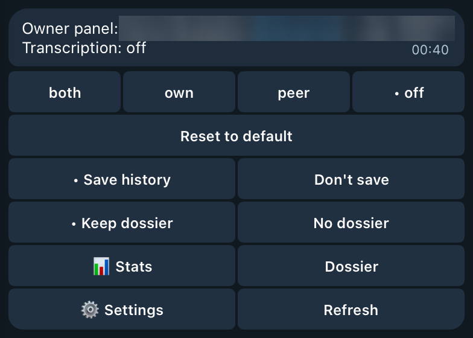
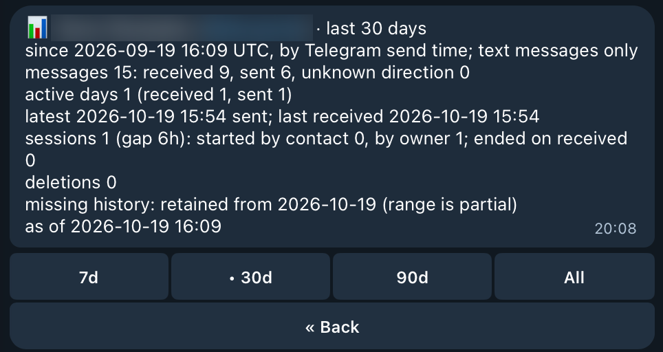

# Telesec

[](https://github.com/neoromantic/telesec/actions/workflows/test.yml)
[](LICENSE)

**Telesec — Telegram Business secretary for [Hermes](https://github.com/NousResearch/hermes-agent).** Voice messages, round video notes, and conservatively recognized attached audio files become readable text without a full agent turn. Optional correspondence history preserves text, edits, and deletions for contact-based search.

[Product demonstration and setup](https://telesec.sergeybaus.com). Telesec is a community plugin and is not affiliated with Nous Research.


## Current module: voice transcription


1. A native Telegram handler intercepts Business `voice`, `video_note`, `audio`, and conservatively identified audio `document` updates before ordinary media processing; generic documents and video are consumed without transcription.
2. Requires a real Telegram Business connection and preserves its `business_connection_id`.
3. Returns `action: skip` so the ordinary auth/agent path does not process the media.
4. Downloads the media transiently and delegates speech recognition to Hermes's configured `transcribe_audio` backend. Attached files must have safe byte/duration metadata, are locally duration-checked when needed, and pass a short mono/16 kHz speech-presence probe before full transcription.
5. Optionally asks the host-owned `ctx.llm` facade for conservative proofreading or opt-in enrichment with ASR correction, filler cleanup, paragraphing, lists, and long-note titles.
6. Publishes the first structurally usable enriched candidate. Empty output or a catastrophic size change gets one feedback retry; raw STT is the last fallback when neither model result is usable.
7. For a short outgoing Business message, appends the transcript to the original voice/video-note caption as an expandable blockquote, retrying the same caption as plain text when Telegram rejects the new entity type.
8. Uses expandable Business-scoped replies for incoming, long, expired, or uneditable messages, with the equivalent plain-text retry.

Handled updates are identified from stable Telegram Business connection, chat, update/message, and relationship data, then suppressed in memory for 24 hours. A successful caption edit suppresses the separate transcript reply, so the chat never receives both forms. PTB `BadRequest` is treated as a definite Telegram-side rejection unless it is the recognized `message is not modified` or unsupported-entity case. Failed entity requests are not treated as delivered before their targeted plain-text retry, and ambiguous post-send transport/backend failures suppress the reply fallback unless remote state is verified. The plugin never runs a separate model provider client and never needs its own credentials.

## Settings

Three switches cover all chats: transcription (on by default), history (off by default), and dossiers (off by default). Change them in your private chat with the bot: send `/telesec`, or tap **⚙️ Settings** on any chat's [owner panel](#per-chat-transcription-modes).

```text
Telesec settings · all chats
One chat: Manage Bot in that chat.
[• Transcribe] [Don't transcribe]
[Save history] [• Don't save]
[Keep dossiers] [• No dossiers]
```

Or from the terminal:

```bash
hermes telesec settings
hermes telesec settings --format json
hermes telesec settings set history on
hermes telesec settings set transcription off
```

A change applies to the next update; no restart is needed. Turning dossiers on asks first and names the model that will receive chat text. Dossiers are built from history, so while history is off they are paused, and Settings says so. Settings speaks Russian when your Telegram app is set to Russian (`Настройки Telesec`).

Only an owner of every Business connection the bot knows about can change the switches; another verified owner sees them read-only. Anyone else's `/telesec`, `/telesec` with more text after it, and `/telesec` in a group go to Hermes as usual, where the `/telesec` command only says that Telesec settings are for the Business account owner. Settings are never posted into a Business chat, and a `/telesec` typed in a Business chat never gets an answer there.

Transcription and history are stored in `$HERMES_HOME/data/telesec/settings.json`, dossiers in `$HERMES_HOME/data/telesec/dossiers/settings.json`, with `0600` permissions and atomic writes. The files hold only the switches and when and how (`telegram`, `cli`, or `migration`) each was set. If `settings.json` becomes corrupt or unreadable, the gateway keeps the switches it last read (transcription on and history off if it never read any) and logs it; Telegram shows an error instead of overwriting it, and only `hermes telesec settings set` backs it up and starts a new one.

Hermes core has more commands than Telegram's "/" menu holds, so `/telesec` is not in the menu by default. To add it, set this in the Hermes config:

```yaml
platforms:
  telegram:
    extra:
      command_menu:
        priority: [telesec]
```

**Upgrade from 0.11.0 or earlier.** `TELESEC_DISABLE`, `TELESEC_HISTORY_ENABLE`, and the Desktop `history_enable` setting are no longer read. On the first start each value that differs from the default (transcription off, history on) is stored once in Settings, and the gateway log says so; the variable still wins over the Desktop setting, as before. A stored choice is never overwritten, and a CLI run without the gateway's environment stores nothing. After that a leftover variable only causes one log warning per start, so you can remove it. No manual step is needed: a gateway with history on keeps it on, transcription stays as it was, and dossiers keep their 0.11.0 switch.

## Per-chat transcription modes

Each Business chat has one mode that covers voice messages, round videos, and attached audio:

| Mode | Transcribes |
|---|---|
| `both` (default) | Your messages and the contact's. |
| `own` | Only your own messages. |
| `peer` | Only the contact's messages. |
| `off` | Nothing in this chat. |

The main control is the owner panel. In any chat where the Business bot is connected, Telegram shows you, the account owner, a "Manage Bot" button. It opens your private chat with the bot, and the bot answers there with that chat's panel:

```text
Owner panel: Casey (@casey) · chat 991
Transcription: off
[both] [own] [peer] [• off]
[Reset to default]
[📊 Stats]
[Dossier]
[⚙️ Settings]
[Refresh]
```



Tap a mode to set it, or Reset to return to the default; the panel message updates in place. The header always ends with `chat <id>`, so when you reply to a panel message to ask the agent about that chat, the reply names the chat. The panel speaks Russian when your Telegram app is set to Russian (`Панель владельца`, `Расшифровка: выкл`, mode buttons `все`, `мои`, `собеседника`, `выкл`) and English otherwise; modes are still stored as `both`, `own`, `peer`, and `off`. Only you see the panel: it lives in your private chat with the bot and the contact sees nothing. Only a verified owner gets the panel. Anyone else's `/start bizChat…` is treated as an ordinary message, and a panel button pressed by anyone else gets a short "Not allowed" alert.

To confirm you are the owner, the bot asks Telegram who owns the Business connections it knows: ones Telegram reported connecting since the gateway started, ones with any Business message since the gateway started (both kept in memory only), ones whose owner the modes file records, ones it already looked up the owner for, and, with history on, the connections in the history catalog. So any message in the chat, yours or the contact's, is enough; no command is needed. While the gateway knows no Business connection at all, Manage Bot answers with a hint to send any message in that chat and tap Manage Bot again. Once it knows one, the `/start` of someone whose connection it does not know yet is handled as an ordinary message. The panel reads and shows per-chat data (such as stats) only for a connection that history lists for the chat or that a message was seen on; otherwise a section says the connection is not known yet. Mode buttons work for the chat right away, even after a restart and before the contact writes again; modes are stored per owner, so your change never touches another owner's chat with the same contact. With transcription off in [Settings](#settings), the panel says so and shows no mode buttons. Other features add their own panel sections, such as the chat's [contact dossier](docs/DOSSIERS.md#in-telegram).

Panel taps and all Business message updates stop update propagation before Hermes' group-99 dispatch counter, so after a quiet period the core "Telegram ingress is healthy but deaf" warning can report a stale gap. The gap resets on reconnect and needs no action.

The only in-chat command is the owner's [`/dossier`](#contact-dossiers-opt-in), which deliberately posts the contact's dossier where the contact sees it. Any other text you type in a Business chat, including `/transcribe`, is ordinary text that the contact sees.

The same modes are available from the CLI:

```bash
hermes telesec mode list
hermes telesec mode get 991
hermes telesec mode set @alice off
hermes telesec mode reset 991
hermes telesec mode get 991 --format json
```

`mode list` and `mode get` take `--format json`. Each chat has `mode` (the stored mode, or `null`), `effective_mode` (what the next voice note gets), and `source`: `stored`, `default`, or `disabled` when transcription is off in [Settings](#settings).

The agent knows these commands too. On Hermes with plugin system prompt sections, the plugin adds a short neutral reference to each new session: the `mode`, `stats`, and `settings` commands with `--format json`, the `history` and `dossiers` skills, and the rule that a reply to a panel message is about the panel's `chat <id>`. So you can reply to a panel message with a question like "how much did we talk this month?".

A chat is a numeric `chat_id` or, with history enabled, a `@username` or name resolved through the history contact catalog. Ambiguous names need the numeric `chat_id` or `--connection`. Without `--owner USER_ID`, a chat on a Business connection whose owner the modes file records belongs to that owner. The connection comes from `--connection`, from the history entry of a chat named by `@username` or name, or, for a numeric `chat_id`, from history when exactly one connection lists that chat. Otherwise the CLI uses the only known owner, where an owner is known once the modes file stores a mode for them or records them as a connection's owner. It does so only when history lists at most one Business connection, or only connections recorded for that owner, since a connection with no recorded owner may belong to another Business account; in every other case pass `--owner`. History does not record owner ids, so on a fresh install the first `set` or `reset` needs `--owner USER_ID`, or one mode change in the owner panel first (Refresh records nothing); `list` and `get` report the default. `set` warns about an `--owner` it has not seen before. If the modes file cannot be read or is corrupt, the CLI reports an error instead of the default; only `set` or `reset` with `--owner` backs a corrupt file up and starts a new one.

Modes are stored per (owner, chat) in `$HERMES_HOME/data/telesec/transcription-modes.json` with `0600` permissions and atomic writes. Each entry holds only the mode, when and how (`chat` or `cli`; a panel change is stored as `chat` so 0.9.0 can still read it) it was set, and a display label for the chat. The file also records which owner each Business connection belongs to: a panel change records it when the panel knows the chat's connection (from history or a message seen since the gateway started), and so does the gateway when it looks up the owner for media in a chat with a non-default mode. The gateway's own lookup never records a connection whose chats all use the default, and a recorded connection stays recorded after its chats return to the default. Telegram's report that the bot was connected is never recorded, since any Business account can connect the bot. It never holds message text or transcripts. The gateway re-reads the file when it changes, so a CLI change applies to the next message without a restart.

The mode is checked once, before any download, speech recognition, or cleanup. A skipped note is still consumed silently: nothing is posted and the ordinary Hermes path does not see it. Logs record the decision and its reason, never content. When something is uncertain the plugin errs toward transcribing:

- A missing modes file, or an empty one (zero bytes or only whitespace), means every chat uses `both`. If the file becomes corrupt or cannot be read, the gateway keeps the modes it last read successfully (`both` everywhere if it never read any) and logs it. A panel change never overwrites a corrupt file and shows an error instead, while the panel still shows the mode the gateway is applying. While the file is corrupt or unreadable, the gateway also stops recording connection owners. Only `set` or `reset` with `--owner` from the CLI backs a corrupt file up and starts a new one.
- Under `own` or `peer`, a message whose direction cannot be determined is transcribed as usual.
- If the Business owner lookup fails, the plugin uses the owner it last recorded for that Business connection, both to pick the mode (so `off` stays off) and to tell own from peer messages under `own`/`peer`. A connection with no recorded owner falls back to transcribing, so one owner's mode never applies to another owner's chat with the same contact.

## Correspondence history

Turn history on in [Settings](#settings) (**Save history**), or from the terminal; no restart is needed:

```bash
hermes telesec settings set history on
```

History then records text in private Business chats. Then search by contact:

```bash
hermes telesec history contacts --search alice --limit 20
hermes telesec history show --contact @alice --since 7d --limit 100
hermes telesec history search --contact @alice --text estimate --since 30d --limit 100
hermes telesec history deletions --status unexplained --limit 20
```

History captures new text messages, edits, and deletions as Telegram delivers them. It preserves deleted text and distinguishes likely corrections, duplicates, unexplained deletions, and missing originals. It does not import old conversations. Contact names and observed aliases are searchable; ambiguous names require an explicit choice.

Canonical storage is profile-local JSONL with a rebuildable contact catalog. Capture and search require no LLM. Media and captions are excluded from history in this version. [History configuration, retention, and CLI](docs/HISTORY.md).

## Correspondence stats

`stats` counts, per contact, text messages received and sent, active days, conversation sessions, latest activity, and deletions over retained history:

```bash
hermes telesec stats --since 30d
hermes telesec stats --contact @alice --since 2026-10-01 --tz Europe/Moscow
hermes telesec stats --contact @alice --format json
```

Messages are placed by Telegram send time. Only text messages are counted. The report needs no LLM, stores nothing new, and never prints message text. [Counting rules, options, and a synthetic example](docs/STATS.md).

The same report for one chat is in Telegram: tap **Manage Bot** in a Business chat, then **📊 Stats** in your private chat with the bot. It is never posted into the Business chat. [Owner panel stats](docs/STATS.md#in-telegram-owner-panel).



## Contact dossiers (opt-in)

With history enabled, turn dossiers on in [Settings](#settings) (**Keep dossiers**, with a confirmation; offered only to an owner of every Business connection the bot knows about) or with `hermes telesec settings set dossiers on` (`hermes telesec dossier enable` still works); no restart is needed. A gateway-only background worker then builds an evidence-backed dossier for every private Business contact, plus one owner writing persona, and refreshes them incrementally through the host `ctx.llm` facade. Every fact cites its source messages. You can trace, correct, pin, or remove facts, and owner edits survive refreshes.

```bash
hermes telesec dossier list
hermes telesec dossier show --contact @alice --fact f3
hermes telesec dossier correct --contact @alice --fact f3 --text "Prefers calls after 18:00."
```

In Telegram, the panel's **Dossier** section shows the chat's dossier as a rich message in your app's language (Russian or English), with pin, unpin, remove, and refresh buttons; the persona is there too, and the on/off switch is in Settings. Sending exactly `/dossier` in a private Business chat, as the owner, deletes the command and posts that contact's dossier into the chat (Telegram allows this only if the contact wrote in the last 24 hours), without owner notes and without quotes or current text of deleted or edited messages (fact texts can still reflect such a message; see [docs/DOSSIERS.md](docs/DOSSIERS.md#dossier-in-a-chat)). Unlike the owner panel, `/dossier` is deliberately visible to the contact: its purpose is to show them their dossier. When there is nothing to post, the bot tells you why in your private chat with it instead.


Enabling dossiers sends private chat text to the configured model provider; history capture alone never does. Nothing reaches a contact unless you send `/dossier`. [Dossiers, Telegram views, privacy, and a synthetic example](docs/DOSSIERS.md).

## Planned assistant

The first layer is implemented: opt-in [contact dossiers and an owner persona](docs/DOSSIERS.md) build editable, evidence-backed context from history. Contextual reply drafts with **Send / Edit / Discard**, plus explicitly enabled per-chat automatic replies with pause and human handover, are planned. Drafts and automatic replies are requirements, not runtime capabilities yet.

See the [roadmap](docs/ROADMAP.md) and [assistant design](docs/ASSISTANT.md).

## Requirements

- Hermes Agent 0.21.6 or newer with `ctx.register_telegram_handler`, CLI/skill registration, `pre_gateway_dispatch`, and `ctx.llm` support. Catalog validation targets Hermes 0.22.2 and PTB 22.8. [Compatibility evidence](docs/VERIFY.md).
- Python 3.11 or newer.
- A configured Telegram gateway with a Telegram Business connection.
- A working Hermes STT provider. Configure it with `hermes setup` or the [`stt` settings](https://hermes-agent.nousresearch.com/docs/user-guide/configuration).
- `ffprobe` and `ffmpeg` on `PATH` for attached-audio duration verification, prefix extraction, and normalization. Voice messages and video notes do not use these gates.

Telegram Business voice/video notes can originate from users outside the ordinary DM allowlist. Enable the plugin's narrowly scoped Business-media authorization bypass in the active profile's `.env` so its native handler can transcribe them:

```bash
TELESEC_VOICE_BYPASS_AUTH=1
```

The plugin registers native Telegram handlers in group `-100`, before ordinary Hermes handlers. After history capture and transcription routing, every `business_message`, `edited_business_message`, and `deleted_business_messages` update is consumed with `ApplicationHandlerStop`. Ordinary Business text from either the owner or a contact never becomes an agent turn, even with history or transcription disabled or after a history-write failure. Normal bot DMs, including the owner panel, keep their existing routing. The bypass above applies only to Business media transcription; it does not authorize ordinary bot messages.

Owners who deliberately want unhandled Business updates to continue into Hermes can set `TELESEC_AGENT_ENABLE=1` in the active profile's `.env` and restart the gateway. The ordinary core auth/agent rules then apply; handled media and owner controls remain consumed.

History has its own switch in [Settings](#settings) and records eligible Business text updates independently of the ordinary DM allowlist. Telegram's selected Business-chat scope and the optional history filters determine what is captured.

## Upgrade from 0.9.x

The runtime ID and catalog key are now `telesec`; the repository is `neoromantic/telesec`. GitHub redirects old repository URLs.

Hermes keys installation directories by plugin name. Stop the gateway and run the upgrade script from a checkout of this version with the gateway's `HERMES_HOME` and Python environment:

```bash
bash scripts/upgrade-telesec.sh
hermes gateway restart
```

The script migrates data and configuration before removing the old installation, then runs `hermes plugins remove telegram-business-voice-transcriber` and `hermes plugins install neoromantic/telesec --enable --yes-deps`. The explicit dependency consent makes the script work non-interactively. First startup also performs the same idempotent migration: `data/telegram-business`, the old plugin cache and plugin state directories, `plugins.entries.telegram-business-voice-transcriber`, and enabled/disabled lists move to `telesec`. History, the contact catalog, transcription modes, and dossiers retain their contents; files remain private (`0600`). A conflicting destination is preserved and reported rather than overwritten. Keep the gateway stopped while resolving a conflict.

For 0.10.x, `hermes telegram-business` remains a deprecated CLI alias. Old `HERMES_TELEGRAM_BUSINESS_*` and `TG_BUSINESS_*` variables are accepted at startup with one deprecation warning; `TELESEC_*` values take precedence. Update your profile environment or systemd drop-ins to the names below. These aliases are removed in the next release.

## Install

```bash
hermes plugins install neoromantic/telesec --enable
hermes gateway restart
```

Inspect the installation:

```bash
hermes plugins list --user
```

Plugins are profile-scoped. Set `HERMES_HOME` or use the appropriate Hermes profile before installing when the gateway does not use the default profile.

## Update and remove

```bash
hermes plugins update telesec
hermes gateway restart
```

```bash
hermes plugins remove telesec
hermes gateway restart
```

`hermes plugins update` uses the Git remote retained by the installer. Both the old redirected source URL and the canonical repository URL remain supported; do not copy the directory manually if you want supported updates. Hermes core updates and this plugin's updates are independent: the installed plugin persists across a core update, while the command above advances the plugin itself.

Removing the plugin leaves its data under `$HERMES_HOME/data/telesec/`: history, dossiers, transcription modes, and settings. To erase it, stop the gateway, remove that directory and any backups or exports you own, then restart. Remove the plugin's environment settings from the active profile too.

## Configuration

All plugin variables are optional. Hermes Desktop's plugin settings form exposes `cleanup_style`, `timezone`, and `agent_enable`. They are read through `ctx.get_config` under `plugins.entries.telesec.settings`; environment variables override the form. Settings are re-read when used. Restart the gateway after changing environment variables or these settings. Transcription, history, and dossiers have no variable or Desktop setting: they are switched in [Settings](#settings) (`/telesec` or `hermes telesec settings set`), with no restart. On upgrade, an old `TELESEC_DISABLE`, `TELESEC_HISTORY_ENABLE`, Desktop `history_enable`, `TELESEC_DOSSIER_ENABLE`, or Desktop `dossier_enable` value is moved into its switch once and then ignored.

```yaml
plugins:
  entries:
    telesec:
      settings:
        cleanup_style: conservative
        timezone: UTC
        agent_enable: false
```

See the [Hermes plugin settings API](https://hermes-agent.nousresearch.com/docs/developer-guide/plugins#store-settings-and-runtime-state).

| Variable | Default | Meaning |
|---|---:|---|
| `TELESEC_AGENT_ENABLE` | false | Allow unhandled Business updates into the ordinary Hermes auth/agent path. By default all Business message updates are consumed after history capture and transcription routing. |
| `TELESEC_SEND_ERRORS` | false | Reply with a short STT error notice. |
| `TELESEC_CLEANUP_DISABLE` | false | Skip LLM cleanup and post raw STT text. |
| `TELESEC_CLEANUP_PROVIDER` | `gemini` | Host provider requested for cleanup. |
| `TELESEC_CLEANUP_MODEL` | `gemini-3.8-flash` | Host model requested for cleanup. |
| `TELESEC_CLEANUP_STYLE` | `conservative` | Use `enriched` for filler removal, active editing, paragraph/list structure, and long-note titles. |
| `TELESEC_CLEANUP_TIMEOUT` | `45` | Cleanup timeout in seconds. |
| `TELESEC_CLEANUP_MIN_CHARS` | `81` | Minimum transcript length for cleanup. |
| `TELESEC_CLEANUP_MIN_WORDS` | `1` | Minimum word count for cleanup. |
| `TELESEC_TITLE_MIN_CHARS` | `700` | Add an enriched-mode title at this transcript length. |
| `TELESEC_TITLE_MIN_WORDS` | `120` | Add an enriched-mode title at this word count. |
| `TELESEC_AUDIO_FILE_MAX_DURATION_SECONDS` | `300` | Maximum attached-audio duration; bounded to 1–3600 seconds. |
| `TELESEC_AUDIO_FILE_MAX_BYTES` | `20971520` | Maximum attached-audio size; bounded to 1024–104857600 bytes. Missing or zero metadata is rejected before download. |
| `TELESEC_AUDIO_FILE_PROBE_SECONDS` | `10` | Prefix duration extracted locally for speech probing; bounded to 1–60 seconds and capped at the configured maximum duration. |
| `TELESEC_AUDIO_FILE_MIN_WORDS` | `3` | Minimum lexical words in the probe transcript; bounded to 1–20. Continuous-script text uses an equivalent conservative letter threshold. |
| `TELESEC_HISTORY_CONNECTIONS` | unset | History: optional comma-separated Business connection filter or `*`. |
| `TELESEC_HISTORY_CHATS` | unset | History: optional exact chat filter or `*`; an exact ID can opt in a chat outside the default types. |
| `TELESEC_HISTORY_CHAT_TYPES` | `private` | History: eligible chat types; add `group`, `supergroup`, or `channel` explicitly. |
| `TELESEC_HISTORY_CORRECTION_WINDOW` | `120` | History: post-delete replacement window and classification delay, in seconds. |
| `TELESEC_HISTORY_NEARBY_BEFORE_SECONDS` | `15` | History: pre-delete replacement window, in seconds. |
| `TELESEC_HISTORY_RETENTION_DAYS` | `0` | History: closed-partition retention target; `0` disables age pruning. |
| `TELESEC_HISTORY_MAX_BYTES` | `1073741824` | History: total storage target before old closed partitions are pruned. |
| `TELESEC_TIMEZONE` | `UTC` | Default `--tz` for [correspondence stats](docs/STATS.md); also the Desktop `timezone` setting. |
| `TELESEC_DOSSIER_INTERVAL_MINUTES` | `30` | Pause between dossier cycles; bounded to 5–1440. |
| `TELESEC_DOSSIER_QUIET_MINUTES` | `10` | Minutes a chat must be quiet before a dossier refresh; bounded to 0–1440. |
| `TELESEC_DOSSIER_BACKFILL_DAYS` | `90` | First-pass and tracking window for dossiers, in days; bounded to 1–3650. |
| `TELESEC_DOSSIER_BACKFILL_MESSAGES` | `500` | First-pass message cap per contact (for the persona, across all chats); bounded to 10–5000. |
| `TELESEC_DOSSIER_MAX_CALLS_PER_MINUTE` | `20` | Dossier model calls per minute; bounded to 1–600. |
| `TELESEC_DOSSIER_PROVIDER` | cleanup provider | Host provider for dossiers; falls back to `TELESEC_CLEANUP_PROVIDER`, then `gemini`. |
| `TELESEC_DOSSIER_MODEL` | cleanup model | Host model for dossiers; falls back to `TELESEC_CLEANUP_MODEL`, then `gemini-3.8-flash`. |

Boolean values accept `1`, `true`, `yes`, or `on` (case-insensitive).

Attached-audio probing is deliberately a conservative speech-presence heuristic, not a perfect content classifier. Empty/failed STT, degenerate text, common no-speech hallucinations, or too little lexical content suppresses full transcription. Telegram audio tracks carrying both title and performer tags are treated as music and skipped. Untagged music with clearly recognized vocals can still be a false positive and proceed to full STT. Files no longer than the probe window reuse the successful probe transcript rather than making a duplicate STT call.

### LLM trust gate

Cleanup uses Hermes's host-owned `ctx.llm`; no provider key belongs in this repository or in plugin-specific files. Explicit provider/model overrides are fail-closed in Hermes. Permit only the provider and model you intend to use:

```yaml
plugins:
  entries:
    telesec:
      llm:
        allow_provider_override: true
        allowed_providers: [gemini]
        allow_model_override: true
        allowed_models: [gemini-3.8-flash]
```

The default is [Gemini 3.8 Flash](https://ai.google.dev/gemini-api/docs/models/gemini-3.8-flash). Cleanup does not pass sampling parameters, following [current Gemini guidance](https://ai.google.dev/gemini-api/docs/whats-new-gemini-3.8). Select another model through `TELESEC_CLEANUP_MODEL` and update the allowlist to match; there is no automatic provider/model switch.

If the trust gate, provider, or model is unavailable, the plugin logs the cleanup failure and posts the raw STT transcript. To use different environment values, update the allowlists to match. To avoid any cleanup LLM call, set `TELESEC_CLEANUP_DISABLE=1`.

Contact dossiers use the same facade and allowlist. By default they request the cleanup provider and model, so the allowlist above covers them; if you set `TELESEC_DOSSIER_PROVIDER` or `TELESEC_DOSSIER_MODEL`, allow those values too. A trust-gate denial stops the dossier cycle, and `hermes telesec dossier status` reports it. `TELESEC_CLEANUP_DISABLE` does not affect dossiers; they make model calls only while they and history are switched on ([Enable](docs/DOSSIERS.md#enable)).

`conservative` preserves conversational wording and accepts almost exclusively punctuation, paragraphing, and obvious ASR fixes. `enriched` actively edits ASR errors and filler, structures topics into paragraphs or real enumerations into lists, and adds a short title to long notes. Its prompt asks the model to preserve the complete meaning, but the runtime deliberately does not attempt token-level semantic proof: any non-empty result between 20% and 200% of the source word count is usable. Output outside that broad structural range gets one feedback retry; raw STT is used only when both candidates are structurally unusable or the cleanup call fails.

## Current module architecture

The plugin registers native Telegram handlers, a `pre_gateway_dispatch` hook, the `telesec` CLI, and the `history` and `dossiers` skills. Business text observations are persisted before normal dispatch; supported media is consumed directly before Hermes downloads it. The voice pipeline normalizes Telegram Business updates before its module sees them. The immutable event includes stable identity, Business connection, chat/user/message/update identifiers, known direction, message/edit timestamps, reply/edit/delete relationships, and provider-neutral media metadata. Direction remains `unknown` when Telegram supplies no outgoing marker; the voice module retains its existing asynchronous Business-owner lookup before editing a caption.

All three native PTB handlers use group `-100`, before Hermes's ordinary Telegram handlers. PTB runs only the first matching handler in a group:

| Handler | Scope and propagation |
|---|---|
| `BusinessHandler` | Business messages, edits, and deletions. Captures history and routes transcription, then raises `ApplicationHandlerStop` unless unhandled agent routing is explicitly enabled. Owner commands and handled media always stop. |
| `OwnerPanelHandler` | Manage Bot `/start bizChat…`, an exact `/telesec` in a private chat, and callback data starting with `tb:` only. Claimed panel actions raise `ApplicationHandlerStop`. |
| `BusinessConnectionHandler` | Business connection updates only; records in-memory connection knowledge and lets core continue. |

There is no `CallbackQueryHandler` registration. The custom panel handler checks the `tb:` prefix before matching, so it leaves core and other plugins' button callbacks alone. Any future `CallbackQueryHandler` must declare `pattern=r"^tb:"` and use the same scoped payload parser.

Source files:

- `__init__.py`: registration, the Telegram handlers and dispatch hook, and the voice pipeline.
- `history_support.py`: history capture and storage, the contact catalog, and the `history` CLI.
- `dossier_support.py`: the opt-in dossier worker, model calls, output validation, and dossier storage.
- `dossier_cli.py`: the `dossier` CLI.
- `dossier_view.py`: pure Telegram views of dossiers (rich HTML, plain fallback, buttons).
- `dossier_panel.py`: the panel's Dossier section and the owner's `/dossier` command.
- `owner_panel.py`: the owner panel's callbacks, section registry, and rendering.
- `global_settings.py`: the switches for all chats, their one-time migration, and the `settings` CLI.
- `settings_panel.py`: the panel's Settings section, also opened with `/telesec`.

Modules are a small ordered tuple. Each module has its own enable check, declares whether it may receive the host-owned LLM facade, and explicitly returns `handled` or `pass_through`. A pass-through result tries the next module; the native handler consumes the remaining Business update unless agent routing is explicitly enabled. A handled result returns `action: skip` immediately and schedules any slow work outside gateway dispatch:

```text
Telegram gateway event
  -> normalize Telegram Business identity and relationships
  -> enabled modules in order
       -> pass_through: try next module
       -> handled: duplicate guard + action: skip (no agent turn)
  -> unhandled Business update: stop propagation unless agent routing is enabled
  -> asynchronous module work
  -> voice/video note: unchanged transient download -> full STT
  -> attached audio: metadata gate -> authoritative getFile-size gate -> transient download -> local ffprobe verification -> ffmpeg prefix probe
  -> unsupported attached-audio container: transient mono/16 kHz WAV normalization
  -> Hermes transcribe_audio (configured host STT; probe first for attached files)
  -> optional ctx.llm structured cleanup
  -> minimal structural sanity check / one feedback retry / raw last fallback
  -> short outgoing message: edit_message_caption(..., caption_entities=[expandable], business_connection_id=...)
  -> otherwise: send_message(..., entities=[expandable], business_connection_id=...)
```

Outgoing direction is checked against the owner returned by Telegram's `getBusinessConnection`; `sender_business_bot` is also accepted as an explicit outgoing signal. Caption text is plain text and limited conservatively to Telegram's 1024 UTF-16 code-unit ceiling. An existing caption is retained unchanged at the start, including its entities, then separated from the transcript by a blank line. A UTF-16-positioned `expandable_blockquote` entity covers only the appended transcript block.

Incoming messages, transcripts that do not fit in one caption, messages outside Telegram's 48-hour Business edit window, uncertain direction, and definite caption-edit rejection, including generic PTB `BadRequest`, use the existing reply path. The first response chunk replies to the original message; continuation chunks use the same Business connection. Caption and reply surfaces follow the same capability policy: use `expandable_blockquote` first, then retry the selected surface once as plain text only after a recognized unsupported-entity rejection. Ambiguous caption-edit transport/backend failures after Telegram may already have seen the request suppress the separate reply instead of risking duplicate transcript delivery.

## Privacy and data

- **No telemetry.** No analytics, usage reporting, tracking endpoint, or self-updater is included.
- **Network.** The gateway's Telegram Bot API client downloads media, looks up Business owners, edits captions, sends transcripts/status messages, and handles owner-panel buttons. For the owner's `/dossier` it deletes that command and posts the contact's dossier into the same Business chat; when it posts nothing, the reason goes only to the owner's private chat with the bot. STT goes to the backend configured in Hermes, which may be local or external. Optional cleanup sends transcripts through `ctx.llm`; opt-in dossiers send retained private-chat text through the same host facade. Provider retention and costs follow your selected backend. The plugin has no separate credential store and does not read credential files.
- **Local processes.** Attached-audio checks run `ffprobe` for duration and `ffmpeg` for prefix extraction and normalization, using argument lists without a shell. They operate on transient media in the active profile's cache.
- **Background work.** Claimed transcription runs asynchronously. Opt-in history schedules deletion classification and maintenance; dossiers use a gateway background thread that starts on adapter connect even while they are off and then only checks the stored switch every minute. Once they are on, cycles start at least 3 minutes after connection and normally 30 minutes apart, and send eligible private-chat text to the configured LLM without another prompt; disable dossiers to stop new cycles.
- **The owner's chat with the bot.** Telegram delivers your own chat with the bot (the owner panel and your agent chat) as Business updates too. The plugin ignores those copies: they are not captured, transcribed, counted, or used for dossiers, and the ordinary update for the same message still reaches Hermes.
- **Stored data and retention.** `$HERMES_HOME/data/telesec/` holds the switches for all chats, owner/chat modes and connection-owner mappings, opt-in history JSONL and its contact catalog, and opt-in dossier facts, source quotes, persona, revisions, and worker state. Modes and dossiers remain until explicitly removed. History defaults to no age pruning and a 1 GiB size target; pruning removes closed monthly partitions, so the current month and pending classifications can exceed the target. See [history removal](docs/HISTORY.md#retention-and-removal), [dossier removal](docs/DOSSIERS.md#storage-and-privacy), and [Update and remove](#update-and-remove).
- Voice/video/audio data is written only to the active Hermes profile's cache while it is processed. The newly created download, attached-audio probe, and any normalized full-file WAV are deleted in a `finally` block after success or failure.
- The configured STT backend receives the media. Depending on your Hermes configuration, that backend may be local or external.
- When cleanup is enabled, the configured host LLM receives the transcript. The system prompt treats transcript contents as untrusted data and forbids following embedded instructions.
- The plugin does not log transcript text. Operational logs include media type, message/chat identifiers, character counts, and errors.
- Error replies are disabled by default. When enabled, the first line of an exception may be sent to the Business chat.
- Voice transcription uses an in-process duplicate key for 24 hours; it resets with the gateway. History uses durable event identities in its JSONL log.
- History is off until turned on in Settings. Once enabled, retained text includes earlier edits and deleted messages. Telegram deletion is not erasure of the local archive; [retention and removal](docs/HISTORY.md#retention-and-removal) are separate controls.
- Contact dossiers are off until turned on in Settings, and pause while history is off. Once enabled, private chat text from the backfill window and later messages goes to the configured host model; groups are never processed. A dossier reaches a contact only when the owner sends `/dossier` in that chat, and owner notes, quotes or current text of deleted or edited messages, and the persona never do. Dossiers keep derived facts, quotes of at most 200 characters, and short message fingerprints, not a second archive. Their logs carry counts, IDs, and error types only. `dossier forget` deletes a dossier and its owner edits without touching history ([storage and privacy](docs/DOSSIERS.md#storage-and-privacy)).
- Existing Hermes/Telegram media caches are outside this plugin's ownership and are never scanned or deleted.

## Known limitations

- Native Telegram handlers require Hermes's in-process plugin mode; `plugins.isolation: host` cannot pass the Telegram Application to this plugin.
- STT currently calls the undocumented core `tools.transcription_tools.transcribe_audio` function. Hermes provides backend-registration APIs but no documented plugin facade to invoke configured STT. This produces a catalog warning and can break on a core update; [submission notes](docs/CATALOG_SUBMISSION.md) explain the dependency.
- History starts when enabled and captures text only; it cannot retrieve old chats, media, or captions. Local history preserves deleted text until retention or explicit removal.
- Dossiers need history and a separate opt-in. They cover private contacts, have no per-contact exclusion, and remain after history is removed. Drafts and automatic replies are planned.
- Attached-audio speech detection is a heuristic; recognized vocals may pass. LLM cleanup can change meaning and adds latency. Raw-first delivery is planned.
- Claimed updates stop before Hermes's group-99 ingress counter, which can produce a stale health warning. Telegram permissions and edit/send windows still apply.

## Failure behavior

- Non-Telegram and non-Business events pass through untouched. Generic documents and video in Business chats are consumed without transcription unless agent routing is explicitly enabled.
- Media skipped by a chat's [transcription mode](#per-chat-transcription-modes) is claimed before download and posts nothing. A modes file that was never readable, unknown direction under `own`/`peer`, or a failed owner lookup on a connection with no recorded owner transcribe as usual.
- Disabled and pass-through modules do not consume the event's duplicate identity.
- A module enable/route exception is logged and contained, and later modules still receive the event.
- Background module exceptions are contained and cannot crash the gateway.
- Missing bot or Business connection data stops processing without invoking an agent.
- STT failure sends nothing unless error replies are enabled.
- Empty STT output sends nothing.
- Attached audio with missing/zero/oversize byte metadata, excessive known duration, unknown local duration, probe extraction/STT failure, or no meaningful probe speech is silently suppressed after being claimed; it never invokes the agent path.
- An initial cleanup call that times out or is denied by the trust gate falls back to raw STT. In `enriched` mode, empty output or a catastrophic size change gets one feedback retry. Ordinary shortening, semantic edits, missing numbers, changed negations, and absent paragraph breaks are not validator failures; the first structurally usable enhancement is published.
- Caption direction checks, length checks, edit-window checks, and definite caption-edit rejections fall back to a separate expandable transcript reply.
- A recognized unsupported-entity response retries the selected caption or reply surface once without the new entity; PTB `BadRequest` counts as a definite caption rejection unless it is the recognized not-modified or unsupported-entity case, while `TimedOut`, other `NetworkError` failures, and unrelated exceptions suppress the reply fallback to avoid duplicates.
- A successful caption edit never also sends a transcript reply.

## Testing

Tests cover the history CLI and disk recovery, transcript behavior, and real PTB handler/HTTP contracts with simulated Telegram responses. They need no Telegram token, provider credential, network call, or running gateway.

```bash
uv sync
uv run pytest -q
```

Live Telegram client rendering and provider cleanup quality require a separate configured smoke test. The [verification guide](docs/VERIFY.md) records the boundary.

## License

[MIT](LICENSE)
