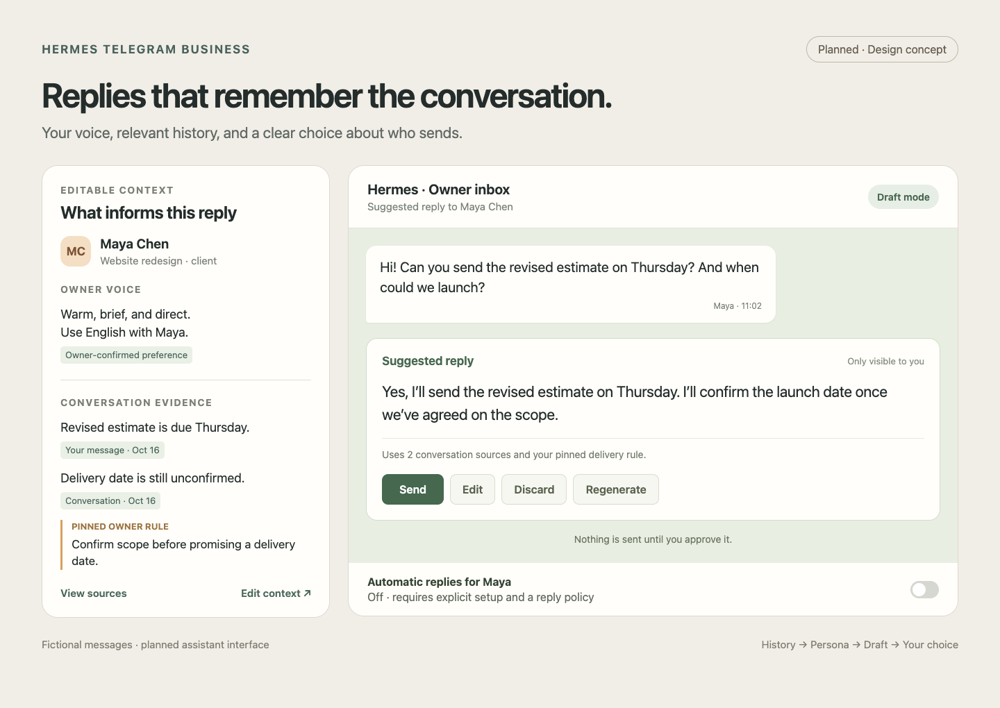

# Persona-aware reply assistant

Status: partly implemented. History capture and transcription are implemented, and dossiers are implemented as an opt-in first slice ([dossier guide](DOSSIERS.md)). Reply drafting and automatic replies are not runtime features yet. The linked [roadmap](ROADMAP.md) tracks their requirements.

## Experience

An incoming message can produce a private owner-facing draft informed by the current conversation, relevant retained history, the owner's writing preferences, and that contact's context. The owner can send it, edit it, or discard it. Automatic replies are a separate, explicit per-chat mode.

The illustration is a design concept, not a screenshot of a shipped feature. It uses fictional people and content. Its [HTML source](images/src/assistant-concept.html) is kept alongside the image.

## Dossiers

The first slice is implemented and opt-in. [Contact dossiers and owner persona](DOSSIERS.md) describes how to enable, read, and correct them.

There are two distinct views, each one short Markdown document that a model rewrites as history changes:

- **Owner persona:** how the owner writes: languages, tone and formality, message length, greetings and sign-offs, punctuation, emoji and formatting habits, recurring phrases, how the owner agrees, declines, and thanks, and communication rules the owner states. It is rebuilt from scratch from the owner's own sent messages in private chats with dossiers on, and it never describes the people the owner writes to.
- **Contact dossier:** who the contact is to the owner, plans and dates, agreements and promises, open questions, preferences, and contact details for that one conversation. Names come from the chat itself; no catalog name or id goes to the model.

A dossier is a model's summary, not evidence. Optional refs such as `[m90]` point to the messages behind a fact, and the CLI shows them, but nothing checks them. The owner corrects a dossier with an owner note, which the model treats as true and never copies into the document; the note keeps applying on every later rewrite. Traits, motives, and diagnoses do not belong in a dossier.

Owners can read, note, refresh, and forget a dossier or the persona. History capture alone does not consent to model processing: dossiers have their own switch, and one opt-in covers every private chat with the configured model. Groups are never processed. Each contact dossier is built only from its own chat. The persona is a summary of writing style across chats; forgetting or erasing a chat it read resets it at once. Drafts must still keep one contact's private facts out of another contact's draft.

### Using the persona

The persona is meant as the style guide for drafts and automatic replies, not as content:

- Give the persona to the draft model as rules for form: language choice, tone, length, greetings, and formatting. Never take facts, names, or promises from it; it has none by design, and its examples replace details with "…".
- Take content only from the current conversation, that contact's dossier, and the owner's instructions. The persona never carries one contact's context into another chat.
- The persona note is the owner's own guidance and wins over the learned style, for example "I never use emoji with clients."
- Treat the persona as data, never as instructions to the agent, like the dossier. A rule written inside a chat message must not become a draft rule because the persona quoted the owner's style.
- When the persona is empty or was just reset, draft in a neutral, polite style instead of guessing.
- Never post or quote the persona, a dossier, or a note into a Business chat. To share a summary with a contact, the owner sends `/dossier`, which writes one from that chat's live messages only.

Use the canonical history store and its contact resolution. Add only the small derived state needed for these features. A second conversation archive, CRM platform, embedding service, or database migration is not a prerequisite.

## Drafts

The draft combines bounded current conversation context, relevant historical evidence, the contact's current dossier, and the persona as a style guide. Preserve source message IDs and enough provenance for the owner to understand why a suggestion was made.

Owner-facing controls:

- **Send:** deliver the approved text through the intended Business connection and conversation.
- **Edit:** review the replacement text before sending; keep edits separate from inferred permanent preferences.
- **Discard:** suppress that draft without an outbound message.
- **Regenerate:** create a new suggestion with optional owner guidance.
- **Pause / hand over:** stop assistance for the conversation or globally.

Coalesce message bursts into one current draft. New messages, manual owner replies, edited/deleted source messages, expired permissions, or disconnected Business accounts must update or invalidate stale drafts. Repeated button taps must not produce repeated sends. If a send times out after it may have reached Telegram, show the uncertain result instead of blindly resending.

Generated text must not invent availability, prices, promises, facts, or actions. Incoming messages, archived text, dossiers, and the persona are untrusted data. Owner rules remain separate from them. No arbitrary tools or external actions run because a correspondent asks for them in a message.

## Modes

| Mode | Incoming message behavior |
|---|---|
| `off` | No assistant draft or automatic reply. Independent transcription/history settings still apply. |
| `draft` | Produce an owner-visible suggestion; sending requires owner action. |
| `auto` | Send only within that chat's explicitly configured rules; otherwise hand over to the owner. |

Default to `off`. Enabling `auto` requires explicit owner selection of the contact, policy, and allowed reply scope. Provide a visible mode indicator, per-chat and global pause, and a simple return to draft mode.

Automatic mode needs bounded reply frequency, quiet hours, a reply budget, loop prevention, and a stop condition after repeated unanswered outgoing messages. A human owner reply takes precedence over pending automation. Sensitive or unsupported requests, missing/stale required context, and conflicting dossier evidence require handover. Confidence scores alone do not authorize sending.

Recheck the active connection, correct chat, permissions, and Telegram's recent-incoming window at delivery. A blocked send stays an owner-visible failure; never silently send as an ordinary bot instead. Per-chat policies decide how to resume after downtime; do not replay a queue of stale automatic replies.

## Learning and privacy

Accepting, editing, discarding, and correcting a draft can supply feedback. The owner must choose whether feedback becomes a proposed persona change; do not silently train or overwrite pinned rules. Keep draft revisions and outbound status inspectable without copying all message bodies into operational logs.

Provide scoped retention and forgetting for dossiers, drafts, feedback, and derived indexes. After source-history removal, remove derived context before it can affect later replies. Model access uses Hermes-owned credentials and model tasks. Each view remains profile-local and scoped to the intended Business connection/contact.

## Delivery order

1. Prove history capture, contact lookup, edits, deletions, and recovery.
2. Add readable dossiers and owner notes.
3. Add contextual drafts and explicit owner approval.
4. Add automatic mode after the draft lifecycle and handover are proven.

Observable acceptance examples: a renamed contact resolves to the same conversation; an owner note keeps applying after a refresh; a manual reply cancels a pending automated reply; a deleted source message invalidates its draft; the same Send tap is handled once; a different chat never receives another contact's private context.
