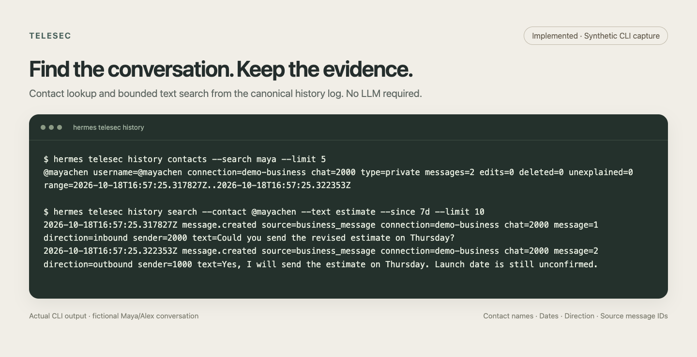

# Correspondence history

History records new Telegram Business text events without an agent turn or an LLM call. It is the source for [contact dossiers and the owner persona](DOSSIERS.md) and for future correspondence features; capturing history does not enable them. Dossiers have their own opt-in.



The image uses synthetic data captured through the real history module and queried through its CLI. [Editable HTML source](images/src/history-search.html).

## Enable capture

History is off by default. Turn it on in [Settings](../README.md#settings): send `/telesec` in your private chat with the bot (or tap **⚙️ Settings** on any chat's panel) and tap **Save history**. Or from the terminal:

```bash
hermes telesec settings set history on
```

No gateway restart is needed: capture starts with the next update. **Don't save** or `hermes telesec settings set history off` stops capture and keeps what was stored; retention and delayed deletion classification keep running. Up to 0.11.0, `TELESEC_HISTORY_ENABLE=1` or the Desktop `history_enable` setting turned history on. On the first start after upgrading, an "on" there is stored in Settings once and the gateway log says so (a variable set to off over a Desktop "on" is stored as off); after that they are ignored. Remove them once you no longer plan to go back to 0.11.0 or older.

By default, capture includes private chats Telegram delivers through the bot's Business connections. Connection and chat filters are optional. Your own chat with the bot (where the owner panel and your agent chat live) is never captured: Telegram also delivers it as Business updates, but it is not a Business chat. The plugin knows it by the bot's id (from the running bot, or from the digits before `:` in `TELEGRAM_BOT_TOKEN`), and readers (history, stats, dossiers, the panel) also skip such a chat if an older version captured it. Groups, supergroups, and channels require explicit configuration. The plugin does not retrieve conversations from before capture started.

Text, edits, deletions, reply relationships, sender/direction, and available contact snapshots are recorded. Media bytes, media metadata, and captions are excluded. Missing original text is recorded as missing rather than reconstructed. The owner's in-chat [`/stats` command](STATS.md#in-a-business-chat-stats), its card or notice, and their edits and deletion are control traffic. They are not recorded while the gateway remembers their message IDs: 24 hours, in memory. After that, or after a gateway restart, an edit or deletion of the card is recorded as an edit or deletion of a message that is not in history.

## One chat

To stop history for one chat, tap **Manage Bot** in that chat and then **Don't save** in your private chat with the bot, or run:

```bash
hermes telesec chat set 991 --history off
hermes telesec chat get 991
hermes telesec chat list
```

**Save history** or `--history on` turns it back on; it is the default, so nothing is stored for it. While a chat is set to Don't save, its new messages, edits, and deletions are not recorded, and its dossier pauses too. What was saved before stays, and retention and the size cap still prune it. Edits and deletions of older messages that arrive in the meantime are not recorded, so turning history back on leaves a gap. The setting is stored per owner in `chat-settings.json` and never touches another owner's chat with the same contact. The check fails closed: if the file was never readable, or the chat id is paused by some owner and the owner of the update's connection cannot be found, nothing is recorded. See [per-chat history and dossier](../README.md#per-chat-history-and-dossier).

## Find a conversation

```bash
hermes telesec history contacts --search alice --limit 20
hermes telesec history show --contact @alice --since 7d --limit 100
hermes telesec history search --contact @alice --text estimate --since 30d --limit 100
hermes telesec history search --text estimate --since 7d --limit 100
hermes telesec history export --contact @alice --format jsonl --limit 200
```

`show`, `search`, and `export` accept either `--contact` or numeric `--chat`; `--connection` disambiguates Business accounts. Duplicate contact names require an explicit choice. Observed names and usernames remain aliases when a contact changes their profile.

Use `--until` with an ISO timestamp to bound the end of a query. Both bounds are inclusive and apply to observation time, rather than the original message's timestamp. Search performs a Unicode-normalized, case-insensitive substring match. It does not use embeddings, interpret intent, or require `jq`.

The bundled `history` skill gives Hermes the same bounded contact-first recipes. Stored text is conversation data, not instructions for the agent.

## Edits and deletions

```bash
hermes telesec history deletions --status unexplained --limit 20
```

Edits append the full updated text. Deletions append a tombstone while preserving earlier text. After the correction window, a deterministic classification is appended:

| Classification | Meaning |
|---|---|
| `likely_duplicate` | Strong normalized resend evidence. |
| `likely_correction` | A nearby, highly similar small edit. |
| `unexplained` | No strong replacement evidence. |
| `unclassifiable` | Original text or sender evidence was unavailable. |

These are observable text-similarity categories, not judgments about a person's intent. Delayed classification runs in the gateway and recovers overdue work at startup. Notifications about deletions are planned separately.

## Configuration

| Variable | Default | Effect |
|---|---|---|
| `TELESEC_HISTORY_CONNECTIONS` | unset | Optional comma-separated connection filter or `*`. |
| `TELESEC_HISTORY_CHATS` | unset | Optional exact chat filter or `*`; exact IDs can opt in a chat outside the default types. |
| `TELESEC_HISTORY_CHAT_TYPES` | `private` | Eligible chat types; explicitly add `group`, `supergroup`, or `channel`. |
| `TELESEC_HISTORY_CORRECTION_WINDOW` | `120` | Post-delete replacement window and classification delay, in seconds. |
| `TELESEC_HISTORY_NEARBY_BEFORE_SECONDS` | `15` | Pre-delete replacement window, in seconds. |
| `TELESEC_HISTORY_RETENTION_DAYS` | `0` | Closed-partition retention target; `0` disables age pruning. |
| `TELESEC_HISTORY_MAX_BYTES` | `1073741824` | Total storage target before pruning old closed partitions. |

Unknown chat types are excluded unless an exact chat ID or earlier canonical profile evidence establishes eligibility. No member-count requests run on capture.

History has no time zone setting: it stores UTC timestamps. [Correspondence stats](STATS.md#time-and-time-zone) show them in the Hermes time zone (`HERMES_TIMEZONE`, or `timezone` in Hermes's `config.yaml`), else UTC, and `--tz` overrides it for one report.

## Storage and recovery

```text
$HERMES_HOME/data/telesec/history/
  <connection-key>/<chat-id>/YYYY-MM.jsonl
  contacts.json
```

JSONL is canonical. Events have durable identities and are appended under a lock with `fsync`; retries do not append the same event twice. The contact catalog is a small derived directory, not a second message database. Monthly partitions follow observation time. Contact queries select the relevant conversation and date partitions before streaming records.

```bash
hermes telesec history stats
hermes telesec history catalog
hermes telesec history catalog --rebuild
hermes telesec history verify
hermes telesec history verify --repair-tails
hermes telesec history maintain
```

`history stats` shows storage stats: records, bytes, and settings. For correspondence stats per contact (text messages received and sent, active days, sessions, and deletions by Telegram send time), use `hermes telesec stats`. See [Correspondence stats](STATS.md).

Read commands do not repair canonical files. `verify --repair-tails` explicitly repairs a torn final line; invalid interior records need investigation. Startup recovery and maintenance operate on persisted history, and the catalog can be rebuilt from retained JSONL. Query results and verification diagnostics are bounded. Human-readable output escapes terminal control characters; JSONL export retains raw text.

## Retention and removal

Telegram-side deletion does **not** erase the archive. The archive deliberately preserves the earlier text to make deletion inspection possible.

Automatic retention and size pruning remove whole closed monthly partitions. The current month and partitions needed for pending deletion classification are preserved, so a configured target is not a hard storage ceiling. The contact catalog is rebuilt from retained evidence after pruning.

Don't save for one chat stops capture but keeps what that chat already has. No record-level erasure command ships in this version. To remove an entire local archive, turn history off in Settings, stop the gateway, back up anything you need, and remove the intended profile-local history directory before restarting. Include any external backups or exports in your own removal process. Removing history does not remove dossiers; use `hermes telesec dossier forget` for those ([storage and privacy](DOSSIERS.md#storage-and-privacy)). Future reply state must support scoped forgetting before it ships.

## Runtime boundary

The native Telegram observer records eligible Business text before ordinary Hermes handlers. It also receives deleted-message updates, which have no effective message. Capture does not change the ordinary Hermes authorization or agent routing of text messages. Turn history off in Settings to stop capturing new messages; use Hermes's normal configuration to control agent replies.

The owner's `/dossier` command (once the bot confirms the sender as the connection's owner) and the dossier the bot posts are never recorded. A `/dossier` whose owner cannot be confirmed is stored as ordinary text, and an owner's edit of a stored message into `/dossier` is recorded as an edit. Dossiers read history only through its read locks and never modify it. `dossier forget` deletes dossier data only and never touches history. When retention or size pruning removes a message a dossier cites, the dossier drops that source. A fact with no sources left becomes unsupported, or `source gone` if the owner pinned or corrected it ([source changes](DOSSIERS.md#source-changes)).

The separate voice module still deletes transient audio after processing. This version does not insert voice transcripts into the text archive automatically.
