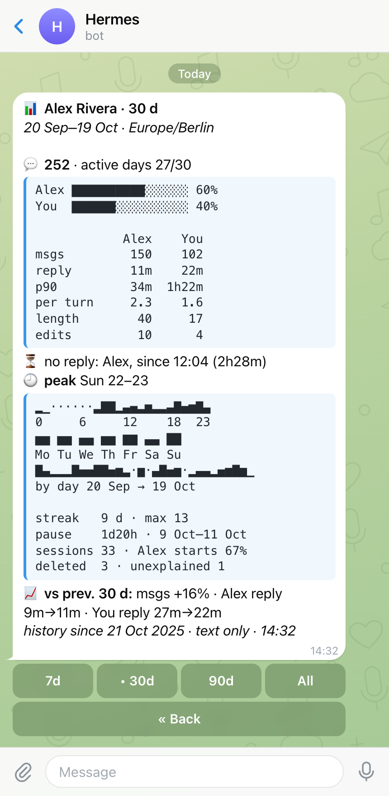
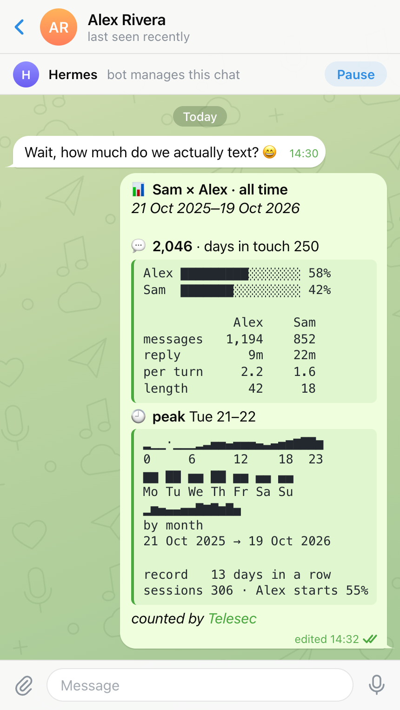

# Correspondence stats

`hermes telesec stats` is a deterministic report over retained [correspondence history](HISTORY.md). For each contact it counts text messages received and sent, active days, conversation sessions, latest activity, and deletions. It also measures the conversation: each side's share, turns, reply times, who is waiting for a reply, message length, edits, the hours and weekdays of activity, activity over time, streaks, the longest silence, and a comparison with the previous period. It also says which history is missing.

It reads only what history has already retained, so capture must be enabled first. It uses no LLM, stores nothing new, and never prints message text. It reads text only to count its characters.

## Commands

```bash
hermes telesec stats
hermes telesec stats --contact @alice --since 30d
hermes telesec stats --chat 991 --connection business-123 --since 2026-10-01 --until 2026-10-18 --tz Europe/Moscow
hermes telesec stats --contact @alice --format json
```

Without `--contact` or `--chat`, the command prints a table of contacts with activity in the range, newest first. With either option, it prints a detailed report for one contact. `--contact`, `--chat`, and `--connection` use the same contact resolver as `history show`. An ambiguous name requires an explicit choice.

| Option | Meaning |
|---|---|
| `--contact` | Contact name, `@username`, or alias from the history catalog. |
| `--chat` | Numeric Telegram chat ID. |
| `--connection` | Business connection ID. Filters the table and disambiguates `--chat` or `--contact`. |
| `--since` | Inclusive start. Default: all retained history. See [Time and time zone](#time-and-time-zone). |
| `--until` | Inclusive end. Default: now. |
| `--tz` | IANA time zone for dates, day boundaries, active days, and hours. Default: the Hermes time zone, otherwise `UTC`. See [Time and time zone](#time-and-time-zone). |
| `--session-gap` | Silence that starts a new session. A whole number with `s`, `m`, `h`, `d`, or `w`, such as `90m` or `1d`. Default: `6h`. |
| `--limit` | Contacts shown in the table, from 1 to 5000. Default: 20. Ignored for one contact. |
| `--format` | `text` or `json`. Default: `text`. |

## Example (synthetic)

The blocks below are real CLI output over fictional history. Four made-up contacts (Alice Example, Bob Builder, Carol, and Dave) were built with the test helpers in `tests/test_stats.py`, with the clock fixed at 2026-10-19 11:32 UTC. A test checks that these blocks still match the command output.

One contact:

```bash
hermes telesec stats --contact @alice --since 2026-10-01 --until 2026-10-18 --tz Europe/Moscow
```

```text
range 2026-10-01..2026-10-18 Europe/Moscow, by Telegram send time; text messages only
Alice Example (@alice) connection=business-123 chat=991
  messages 9: received 5, sent 3, unknown direction 1
  active days 4 (received 3, sent 3)
  latest 2026-10-17 21:04 received; last sent 2026-10-17 19:30
  last message: received 2026-10-17 21:04, no observed reply after it
  sessions 4 (gap 6h): started by contact 2, by owner 2; ended on received 2
  share received 63%, sent 37%
  turns 7 (received 4, sent 3); messages per turn received 1.3, sent 1.0
  replies received 2: median 52m, p90 1h34m; sent 1: median 30m, p90 30m
  text length median received 10, sent 10; edited 2 (received 0, sent 1, unknown direction 1)
  peak Sat 12:00; hours 0..23: 1 0 0 0 0 0 0 0 0 0 0 2 3 0 0 0 0 0 0 1 0 1 0 1; weekdays Mon..Sun: 0 0 0 0 0 8 1
  activity by day from 2026-10-01: 0 0 3 1 0 0 0 0 0 3 0 0 0 0 0 0 2 0
  streak current 1d, longest 2d (2026-10-03..2026-10-04); longest silence 7d07h (2026-10-10 12:14..2026-10-17 19:30)
  deletions 4: unexplained 1 (received 1, sent 0), likely correction 1, likely duplicate 1, pending 1
  missing history: retained from 2026-10-03 (range is partial); 1 deletion of a message not in history; 1 message known only from an edit
  deletion details: hermes telesec history deletions --connection business-123 --chat 991 --status unexplained
```

The same contact for the last 7 days. The range runs to now, so the report says who is waiting for a reply. Retained history covers the 7 days before the range too, so the report compares with them:

```bash
hermes telesec stats --contact @alice --since 7d --tz Europe/Moscow
```

```text
range 2026-10-12 14:32..now Europe/Moscow, by Telegram send time; text messages only
Alice Example (@alice) connection=business-123 chat=991
  messages 3: received 2, sent 1, unknown direction 0
  active days 2 (received 2, sent 1)
  latest 2026-10-19 00:00 received; last sent 2026-10-17 19:30
  last message: received 2026-10-19 00:00, no observed reply after it
  sessions 2 (gap 6h): started by contact 1, by owner 1; ended on received 2
  share received 67%, sent 33%
  turns 2 (received 1, sent 1); messages per turn received 2.0, sent 1.0
  replies received 1: median 1h34m, p90 1h34m; sent 0
  waiting received since 2026-10-17 21:04 (1d17h)
  text length median received 10, sent 10; edited 0
  peak Sat 00:00; hours 0..23: 1 0 0 0 0 0 0 0 0 0 0 0 0 0 0 0 0 0 0 1 0 1 0 0; weekdays Mon..Sun: 1 0 0 0 0 2 0
  activity by day from 2026-10-12: 0 0 0 0 0 2 0 1
  streak current 1d, longest 1d (2026-10-17..2026-10-17); longest silence 1d02h (2026-10-17 21:04..2026-10-19 00:00)
  previous 2026-10-05 14:32..2026-10-12 14:31: messages 3 -> 3 (+0%); active days 1 -> 2; reply median received 10m -> 1h34m, sent -
  deletions 1: pending 1
  missing history: none (retained from 2026-10-03)
```

All contacts:

```bash
hermes telesec stats --since 2026-10-01 --until 2026-10-18 --tz Europe/Moscow
```

```text
range 2026-10-01..2026-10-18 Europe/Moscow, by Telegram send time; text messages only
latest            last      msgs  recv  sent  unk  days  sess  del  unexpl  partial  connection    chat  contact
2026-10-18 09:15  sent         2     1     1    0     1     1    0       0  yes      business-123  992   Bob Builder (@bob)
2026-10-17 21:04  received     9     5     3    1     4     4    4       1  yes      business-123  991   Alice Example (@alice)
-                 -            0     0     0    0     0     0    1       0  no       business-456  994   Carol
shown 3 of 4 contacts; not shown: 1 with no activity in range
missing history in shown contacts: 1 deletion of a message not in history; 1 message known only from an edit; use --contact for details
deletion details: hermes telesec history deletions --status unexplained
```

Carol has only a deletion in the range, so her row comes last. Dave wrote only in September, so he is not shown, and the footer says so.

JSON for one contact. It is trimmed here: `chat_type`, `name`, `username`, `active_days`, `sessions`, `hours`, and `weekdays` are left out, and the `counts` list is on one line. Real output always has every key.

```bash
hermes telesec stats --contact @alice --since 2026-10-01 --until 2026-10-18 --tz Europe/Moscow --format json
```

```json
{
  "schema_version": 2,
  "report": "correspondence_stats",
  "mode": "contact",
  "generated_at": "2026-10-19T14:32:00+03:00",
  "range": {
    "since": "2026-10-01T00:00:00+03:00",
    "until": "2026-10-18T23:59:59.999999+03:00",
    "timezone": "Europe/Moscow",
    "time_basis": "telegram_send_time",
    "deletion_time_basis": "deletion_observed_time",
    "content": "text_messages_only",
    "session_gap_seconds": 21600
  },
  "contacts": [
    {
      "business_connection_id": "business-123",
      "chat_id": 991,
      "display_name": "Alice Example (@alice)",
      "messages": {
        "total": 9,
        "received": 5,
        "sent": 3,
        "unknown_direction": 1
      },
      "latest": {
        "at": "2026-10-17T21:04:00+03:00",
        "side": "received",
        "received_at": "2026-10-17T21:04:00+03:00",
        "sent_at": "2026-10-17T19:30:00+03:00",
        "observed_reply": "none"
      },
      "deletions": {
        "total": 4,
        "unexplained": {
          "total": 1,
          "received": 1,
          "sent": 0,
          "unknown_direction": 0
        },
        "likely_correction": 1,
        "likely_duplicate": 1,
        "unclassifiable": 0,
        "pending": 1,
        "details_command": "hermes telesec history deletions --connection business-123 --chat 991 --status unexplained"
      },
      "missing_history": {
        "retained_from": "2026-10-03T11:00:05+03:00",
        "range_partial": true,
        "deletions_of_messages_not_in_history": 1,
        "messages_known_only_from_edit": 1
      },
      "share": {
        "received": 63,
        "sent": 37
      },
      "turns": {
        "total": 7,
        "received": 4,
        "sent": 3,
        "messages_per_turn": {
          "received": 1.3,
          "sent": 1.0
        }
      },
      "replies": {
        "received": {
          "count": 2,
          "median_seconds": 3120,
          "p90_seconds": 5640
        },
        "sent": {
          "count": 1,
          "median_seconds": 1800,
          "p90_seconds": 1800
        }
      },
      "waiting": null,
      "text_length_median": {
        "received": 10,
        "sent": 10
      },
      "edited": {
        "total": 2,
        "received": 0,
        "sent": 1
      },
      "peak_hour": 12,
      "peak_weekday": 5,
      "activity": {
        "bucket": "day",
        "start": "2026-10-01",
        "counts": [0, 0, 3, 1, 0, 0, 0, 0, 0, 3, 0, 0, 0, 0, 0, 0, 2, 0]
      },
      "streaks": {
        "current_days": 1,
        "longest_days": 2,
        "longest_start": "2026-10-03",
        "longest_end": "2026-10-04"
      },
      "silence": {
        "seconds": 630930,
        "from": "2026-10-10T12:14:30+03:00",
        "to": "2026-10-17T19:30:00+03:00"
      },
      "previous": null
    }
  ],
  "overview": null
}
```

## What is counted

- **Text messages only.** History stores text messages only. Voice notes, video notes, media, captions, and service messages are not in the archive and are not counted. Every report says "text messages only".
- **Message.** One message is one `(connection, chat, message_id)`. It is counted once: edits and repeated deliveries do not add messages.
- **Sent and received.** Sent is the owner side (outbound). Received is the contact side (inbound). A message with `unknown direction` is shown on its own and is not part of sent or received. The latest version of a message with a known direction decides its side, so an edit can change it. An edit with unknown direction does not erase a known side. "Latest" means the order history recorded events in, as with the other history commands, so a capture clock that stepped backwards cannot reorder them. The same rule picks a deletion's latest classification.
- **Deleted messages.** A deleted message still counts as sent or received, because it was sent. The exception is a deletion classified `likely_duplicate` or `likely_correction`. Another message replaced it, so it is not counted again. Replaced messages are also left out of active days, latest activity, and sessions.
- **Deletions.** The deletions line counts deleted messages, one per message, by status: `unexplained`, `likely correction`, `likely duplicate`, `unclassifiable`, and `pending` (not classified yet). When a message has several deletion records, the first status in this order wins: likely duplicate, likely correction, unexplained, unclassifiable, pending.
- **Deletion time.** A deletion falls into the range by the time it was first observed, not by the message's send time. A message sent before the range and deleted inside it is on the deletions line, but not in the message count.
- **Side of a deletion.** Unexplained deletions are split by the side of the deleted message: received, sent, and unknown direction when above 0. Telegram does not report who deleted a message, so the report never says who did. When there are unexplained deletions, the report prints the `history deletions` command for details. That command lists every unexplained deletion in the chat, not only those in the range.
- **Active days.** The number of distinct calendar dates in `--tz` with at least one counted message. Also shown for received and for sent. Unknown-direction messages count in the total only.
- **Latest activity.** The latest counted message and its side, plus the latest received and the latest sent message.
- **Last message.** When the latest counted message is received, a `last message:` line follows. "no observed reply after it" means history has no sent message after it. "reply observed after the range" means a sent message came after it, but after `--until`. This is an observation, not a guess about intent: a reply by voice, by phone, or outside Telegram is not in history.
- **Sessions.** Counted messages in the range are sorted by send time, then by message ID. A new session starts when the gap since the previous message is longer than `--session-gap` (default 6 hours). A gap exactly equal to it stays in the same session. Unknown-direction messages take part in session boundaries. The report gives the number of sessions, who started them (contact, owner, and unknown when above 0), and how many ended on a received message. Only messages inside the range are used, so a session that crosses a range boundary is cut at that boundary.

## Conversation metrics

These lines follow the sessions line. They use the same counted messages: text messages in the range, without replaced deletions, sorted by send time, then by message ID. When the range has no counted message, they are left out. Only the `previous` line can still show, because the previous period may have messages. Durations are rounded down and printed as `40s`, `12m`, `1h40m`, `3h05m`, or `4d02h`. A `-` means that a value is not known.

- **Share.** `share received 63%, sent 37%`: each side's percent of the messages with a known side. Received is rounded half up, and sent is 100 minus received. The line is left out when no message has a known side.
- **Turns.** A turn is a run of consecutive messages from the same side. An unknown-direction message ends the current turn and does not start one. `turns 7 (received 4, sent 3)` counts turns per side. `messages per turn` is each side's messages divided by its turns, rounded half up to one decimal.
- **Replies.** When a turn of one side comes right after a turn of the other side, it is a reply. The reply time is the gap from the last message of the earlier turn to the first message of the reply. A gap longer than `--session-gap` is a new conversation, not a reply. An unknown-direction message between the two turns also means no reply. `replies received` are the contact's replies; `replies sent` are the owner's. Each side shows the number of replies, the median, and p90. The median is the middle value (the mean of the two middle values for an even count), rounded half up to whole seconds. p90 is the nearest-rank 90th percentile: the value at position ceil(0.9 × n) in sorted order. When a side has no replies, only its count `0` is shown.
- **Waiting.** Only when the range runs to now (no `--until`). The last turn with a known side has no reply yet. `waiting received since <time> (<how long>)` means the contact's turn waits for the owner; `waiting sent` means the owner's turn waits for the contact. The time is the first message of that turn, and the duration runs to now. Unknown-direction messages after that turn do not end the wait. This is an observation, not a judgment: a reply by voice, by phone, or outside Telegram is not in history.
- **Text length.** The median number of characters per message, for each side. It is the length of the latest text of a message, without spaces at the start and end, counted in Unicode code points. Only the length is used; the text is never stored or printed.
- **Edited.** Counted messages with at least one observed edit. Split by side, with unknown direction when above 0.
- **Hours and weekdays.** Counted messages per local hour (0 to 23) and per weekday (Monday to Sunday) in `--tz`, unknown direction included. On a day when clocks change, hours follow the local clock. `peak Sat 12:00` is the busiest weekday and the busiest hour, each on its own. A tie goes to the earliest.
- **Activity.** Counted messages per period over the whole range, for a chart. The range is from `--since` (or the first counted message without it) to `--until` (or now), in `--tz`. The period is the smallest of day, week (Monday to Sunday), month, quarter, and year that gives at most 31 values. `activity by week from 2026-09-28: ...` names the period and the start of the first one.
- **Streaks.** Days in a row with at least one counted message, in `--tz`. `longest` is the longest run with its dates; a tie goes to the earliest. `current` is the run that ends on the last day of the range (today without `--until`) or on the day before it, so a streak is still alive until a full day passes without messages. Otherwise it is `0d`.
- **Longest silence.** The longest gap between two consecutive counted messages, with both times. A tie goes to the earliest. It needs at least two messages.
- **Previous period.** Only with `--since`. The previous period has the same length and ends right before `--since`. When the range is whole days (it starts at midnight, as a date `--since` does, and runs to now or to the end of a day), the previous period is as many whole days: on 2026-10-19, `--since 2026-10-13` compares with 2026-10-06..2026-10-12. The line shows both periods side by side: messages with the percent change, active days, and the median reply time per side. It is shown only when retained history covers all of the previous period, so a comparison never uses a period that is partly missing. Deletions are not compared.

## Missing history

Missing history is shown on its own line. It is never mixed into the counts.

- **Retained from.** The date the chat's retained history starts: its first retained observation. If `--since` is earlier, the report says "(range is partial)": history was not captured yet, or it was pruned. Without `--since`, the report is never partial.
- **Deletions of messages not in history.** A deletion observed in the range, of a message with no retained record and no known send time. It is not on the deletions line and does not make a contact active. If the deletion record still has the original send time, it counts as a normal deletion with that record's side.
- **Messages known only from an edit.** An edit of a message whose original was never captured (it was sent before capture started) or was pruned. It is listed when its send time is in the range. It is not counted.

When nothing is missing, the line reads `missing history: none (retained from <date>)`.

Stats are computed live from retained JSONL. Retention removes whole monthly partitions, so pruned messages drop out of the counts on their own. The partial marker shows where retained history begins.

Messages [imported from a Telegram Desktop export](HISTORY.md#import-past-messages) count like captured ones, with their Telegram send time and side. An import moves "retained from" back to its first message, and an edited imported message counts as edited.

## Time and time zone

- Messages are placed by Telegram's send time (`message_at`), not by the time the bot observed them. If the send time is missing, the first observation time is used.
- `--tz` takes an IANA name such as `Europe/Moscow`. Without it, the report uses the Hermes time zone (`HERMES_TIMEZONE`, or `timezone` in Hermes's `config.yaml`), then UTC. Telesec has no time zone setting of its own. The report always prints the time zone it used. An unknown name in `--tz` is an error. An unknown Hermes time zone is ignored, and the report uses UTC. Named zones need the system time zone database or the Python `tzdata` package; `UTC` always works.
- `--since` and `--until` accept:
  - relative values such as `30m`, `6h`, `7d`, or `2w`, counted back from now;
  - plain dates such as `2026-10-01`: the start of that day for `--since`, and the end of that day for `--until`, in `--tz`. Other ISO date forms, such as `20261001`, work too;
  - ISO timestamps. A timestamp without an offset is read in `--tz`. A timestamp with `Z` or an offset keeps it.
- Both bounds are inclusive. `--until` must not be earlier than `--since`. Without `--since`, the report covers all retained history. Without `--until`, it runs to now.
- The first line shows the range. Whole-day bounds print as dates, other bounds as `YYYY-MM-DD HH:MM` in `--tz`. Open bounds print as `start of history` and `now`.
- The report uses what is known at report time. An edit, deletion, or classification observed after `--until` still applies to a message sent inside the range.

These rules differ from `history show` and `history search`. Their bounds apply to observation time, and they read a timestamp without an offset as UTC.

Stats use the time zone Hermes already has. To set it, add `timezone: Europe/Moscow` to the active Hermes profile's `config.yaml`, or `HERMES_TIMEZONE=Europe/Moscow` to its `.env`, then restart the gateway. This changes the time zone for all of Hermes. For one report in another zone, pass `--tz`.

## Contacts table

Each row is one chat with at least one counted message or counted deletion in the range. Rows with messages come first, newest latest message first. Rows with only deletions follow. Ties are broken by connection, then chat. The same chat ID under two Business connections gives two rows.

| Column | Meaning |
|---|---|
| `latest` | Latest counted message in `--tz`, or `-`. |
| `last` | Side of the latest message: `received`, `sent`, `unknown`, or `-`. |
| `msgs`, `recv`, `sent`, `unk` | Messages: total, received, sent, unknown direction. |
| `days` | Active days. |
| `sess` | Sessions. |
| `del`, `unexpl` | Deletions, and unexplained deletions. |
| `partial` | `yes` when the range starts before retained history. |
| `connection`, `chat`, `contact` | Business connection, chat ID, and contact name. |

The footer says how many contacts were shown out of all contacts in scope, and why the rest were not shown: over `--limit`, or no activity in the range. It also sums missing history for the shown rows, and prints the `history deletions` command when a shown row has unexplained deletions. With no active contacts, the table is replaced by `No contacts with activity in range.` With no history at all, the command prints `No Telegram Business history found.`

A contact with no activity in the range is not a row, but its missing history is still reported, apart from the counts. "No activity" can mean that history for that time was never captured or was pruned, so the activity is unknown, not zero. When `--since` is earlier than a hidden contact's retained history, the footer says so:

```text
range 2026-09-01..2026-09-30 UTC, by Telegram send time; text messages only
No contacts with activity in range.
shown 0 of 3 contacts; not shown: 3 with no activity in range (range is partial for 2: retained history starts after --since)
missing history in contacts with no activity in range: 1 message known only from an edit; use --contact for details
```

Here two of the three contacts have retained history only from October, so their September activity is unknown. The last line sums deletions of messages not in history and messages known only from an edit for the hidden contacts. To find them, `history contacts` prints each contact's retained range (`range=`), and `stats --contact` prints one contact's missing history.

## JSON output

`--format json` prints one JSON document with stable keys. Both modes use the same shape. Every key is always present; a value that is not known is `null`.

| Key | Meaning |
|---|---|
| `schema_version` | `2`. Version 2 added the conversation metrics, after `missing_history`. |
| `report` | `correspondence_stats`. |
| `mode` | `contact` or `overview`. |
| `generated_at` | Report time. |
| `range` | `since`, `until`, `timezone`, `time_basis` (`telegram_send_time`), `deletion_time_basis` (`deletion_observed_time`), `content` (`text_messages_only`), and `session_gap_seconds`. |
| `contacts` | One object per contact. In overview mode, the shown rows in table order. |
| `overview` | `null` for one contact. Otherwise `contacts_in_scope`, `active`, `shown`, `limit`, `not_shown_over_limit`, `not_shown_no_activity`, `not_shown_no_activity_partial`, and `not_shown_no_activity_missing_history`. |

The last two keys cover contacts with no activity in the range, which are not in `contacts`. `not_shown_no_activity_partial` is how many of them have `range_partial`: their retained history starts after `--since`, so their activity in the range is unknown, not zero. `not_shown_no_activity_missing_history` sums `deletions_of_messages_not_in_history` and `messages_known_only_from_edit` over them. Neither is part of any count.

Each contact object has:

| Key | Contents |
|---|---|
| identity | `business_connection_id`, `chat_id`, `chat_type`, `display_name`, `name`, `username` |
| `messages` | `total`, `received`, `sent`, `unknown_direction` |
| `active_days` | `total`, `received`, `sent` |
| `latest` | `at`, `side` (`received`, `sent`, `unknown`, or `null`), `received_at`, `sent_at`, `observed_reply` (`none`, `after_range`, or `null`) |
| `sessions` | `total`, `started_by_contact`, `started_by_owner`, `started_by_unknown`, `ended_on_received` |
| `deletions` | `total`, `unexplained` (`total`, `received`, `sent`, `unknown_direction`), `likely_correction`, `likely_duplicate`, `unclassifiable`, `pending`, `details_command` (`null` without unexplained deletions) |
| `missing_history` | `retained_from`, `range_partial`, `deletions_of_messages_not_in_history`, `messages_known_only_from_edit` |
| `share` | `received`, `sent`: percent of messages with a known side, or `null` without any |
| `turns` | `total`, `received`, `sent`, `messages_per_turn` (`received`, `sent`: one decimal, `null` without turns on that side) |
| `replies` | `received` (the contact's replies) and `sent` (the owner's), each with `count`, `median_seconds`, and `p90_seconds` (`null` without replies) |
| `waiting` | `null`, or `side` (`received`: the contact waits; `sent`: the owner waits), `since` (first message of the unanswered turn), and `seconds` (up to `generated_at`). Always `null` with `--until`. |
| `text_length_median` | `received`, `sent`: median characters per message, or `null` |
| `edited` | `total` (unknown direction included), `received`, `sent` |
| `hours` | 24 counts, local hours 0 to 23 |
| `weekdays` | 7 counts, Monday to Sunday |
| `peak_hour`, `peak_weekday` | Index of the largest count in `hours` and `weekdays` (Monday is 0), the earliest on a tie, or `null` without messages |
| `activity` | `null` when there is no `--since` and no counted message. Otherwise `bucket` (`day`, `week`, `month`, `quarter`, or `year`), `start` (date the first bucket starts), and `counts` |
| `streaks` | `current_days`, `longest_days`, `longest_start`, `longest_end` (dates, `null` without messages) |
| `silence` | `null` with fewer than two messages. Otherwise `seconds`, `from`, and `to` |
| `previous` | `null` without `--since` or when retained history does not cover the previous period. Otherwise `since`, `until`, `messages` (`total`), `active_days` (`total`), and `replies` (`received` and `sent`, each with `median_seconds`) |

Timestamps are ISO 8601 in `--tz`, with the offset. Dates (`start`, `longest_start`, `longest_end`) are `YYYY-MM-DD` in `--tz`. The output is ASCII; other characters are escaped. Errors are a plain `error: ...` line with exit code 1, also with `--format json`.

## In Telegram (owner panel)

The one-contact stats are also in Telegram, in your private chat with the bot. Open a Business chat and tap **Manage Bot**. Telegram opens your private chat with the bot, and the bot shows the owner panel for that chat. Tap **📊 Stats**.



This is a real Telegram for macOS screenshot of the view over fictional history. The fictional history is Alex Rivera and the owner Sam, about 2,000 text messages over 12 months, run through the real view. It is also in [Russian](images/stats-panel-ru@2x.png). [`scripts/render-stats-screenshots.py`](../scripts/render-stats-screenshots.py) writes the exact rich message HTML of each view to `images/src/`, ready to send for a screenshot.

The buttons under the report pick the period:

| Button | Period | Same as the CLI with, on 2026-10-19 |
|---|---|---|
| `7d` | Today and the 6 days before it. | `--since 2026-10-13` |
| `30d` | Today and the 29 days before it. The default. | `--since 2026-09-20` |
| `90d` | Today and the 89 days before it. | `--since 2026-07-22` |
| `All` | All retained history. | no `--since` |

A period is whole local days: it starts at midnight of its first day, so `7d` shows 7 days, not 8 partial ones. The current period is marked `•`. Tap it again to refresh. The report runs to now. It uses the default time zone of the CLI (the Hermes time zone, else UTC) and the default 6-hour session gap. So the numbers are the same as `hermes telesec stats --chat <id> --connection <id>` with that `--since` date, run at the same moment.

The report speaks the language of your Telegram app: Russian for a Russian app, English otherwise. In Russian the buttons are `7 дн.`, `30 дн.`, `90 дн.`, and `Всё`. It is a Telegram rich message: headings, tables, and a quote, with no code blocks. The contact is always 🟦 and you are always 🟩. Heat maps use `·` for zero, then 🟨, 🟧, and 🟥 for up to a third, two thirds, and all of the largest value in the same table. They sit in table cells, so the columns line up in any font. From top to bottom:

- **Title.** The contact and the period (`7 days`, `30 days`, `90 days`, or `all time`).
- **Dates and totals.** The dates the period covers, 💬 messages, and active days out of the days in the period.
- **Balance.** One bar of 10 squares with each side's share around it, such as `58% 🟦🟦🟦🟦🟦🟦🟩🟩🟩🟩 42%`. A side with any messages gets one square at least. Left out when a side's share is not known.
- **Table.** Per side: messages with the share, ⚡ median reply time, p90 reply time, messages per turn, median text length, and edits (only when there are edits). `–` means there is no data.
- **⏳ Waiting.** Who is still waiting for a reply, and for how long. Left out when nobody is waiting. It shows no clock time, since Telegram may show the message in another time zone.
- **🗓 When.** Heat maps of activity over the period, then weekdays and three-hour blocks of the day (0, 3, …, 21). The period map depends on its length: a calendar of weeks for days (it then shows the weekdays itself), a row of weeks per month, a row of months per year, a row of quarters per year, or the years. Cells outside the period are empty. When history starts after the period does, the map starts at history's first day (or at an earlier imported message), so days with no history do not look like days without messages.
- **🎯 Peak.** The busiest weekday and hour.
- **Tiles.** 🔥 the current streak of active days, 🏆 the longest one, 💤 the longest pause, 🗣 sessions, 👋 who starts sessions more often and how often, and 🗑 deletions with ❓ the unexplained ones (only when there are deletions).
- **📈 Previous period.** The change in messages and in each side's median reply time against the same number of days right before the period. Left out when retained history does not cover the previous period, and for `All`.
- **Footer.** When history starts, and `text only`.

Durations are rounded down: `45 s`, `12 min`, `2 h 10 min`, `2 h`, `1 d 17 h`, `12 d`. A zero minor unit is left out, and days show hours only below 10 days. Numbers have a thousands separator: `1,284` in English and `1 284` in Russian, and Russian decimals use a comma (`2,4`). The deletion details, missing history counts, the turn counts, and the latest activity are CLI-only.

When Telegram does not take the rich message, the panel shows a short plain-text version instead: the title, dates and totals, each side's messages and median reply time, who is waiting, the peak, and the footer. A very large report drops the heat maps first, then the tiles; the title, the paused line, and the footer always stay.

Example (synthetic): Alice from the [example above](#example-synthetic), period `30d`, Hermes time zone `Europe/Moscow`, clock at 2026-10-19 11:32 UTC, English app. This is the exact rich message HTML; the period buttons and a Back button come below it. A test checks that this block still matches the real view.

```html
<h3>📊 Alice Example · 30 days</h3>
<p>20 Sep – 19 Oct · 💬 <b>10</b> · <b>5</b> of 30 days</p>
<p>67% 🟦🟦🟦🟦🟦🟦🟦🟩🟩🟩 33%</p>
<table striped compact>
<tr><th></th><th align="right">🟦 Alice</th><th align="right">🟩 You</th></tr>
<tr><td>messages</td><td align="right"><b>6</b> · 67%</td><td align="right"><b>3</b> · 33%</td></tr>
<tr><td>⚡ reply</td><td align="right"><b>52 min</b></td><td align="right"><b>30 min</b></td></tr>
<tr><td>p90</td><td align="right">1 h 34 min</td><td align="right">30 min</td></tr>
<tr><td>per turn</td><td align="right">1.5</td><td align="right">1.0</td></tr>
<tr><td>length</td><td align="right">10</td><td align="right">10</td></tr>
<tr><td>edits</td><td align="right">0</td><td align="right">1</td></tr>
</table>
<blockquote>⏳ Alice is waiting for your reply <b>1 d 17 h</b></blockquote>
<h4>🗓 When</h4>
<table compact>
<tr><th>Mo</th><th>Tu</th><th>We</th><th>Th</th><th>Fr</th><th>Sa</th><th>Su</th></tr>
<tr><td></td><td></td><td></td><td></td><td></td><td>🟥</td><td>🟨</td></tr>
<tr><td>·</td><td>·</td><td>·</td><td>·</td><td>·</td><td>🟥</td><td>·</td></tr>
<tr><td>·</td><td>·</td><td>·</td><td>·</td><td>·</td><td>🟧</td><td>·</td></tr>
<tr><td>🟨</td><td></td><td></td><td></td><td></td><td></td><td></td></tr>
</table>
<table compact>
<tr><th>0</th><th>3</th><th>6</th><th>9</th><th>12</th><th>15</th><th>18</th><th>21</th></tr>
<tr><td>🟧</td><td>·</td><td>·</td><td>🟧</td><td>🟥</td><td>·</td><td>🟨</td><td>🟧</td></tr>
</table>
<p>🎯 Peak — <mark>Sat, 12–13</mark></p>
<table compact>
<tr><td>🔥 streak</td><td align="right"><b>1</b> day</td><td>🏆 record</td><td align="right"><b>2</b> days</td></tr>
<tr><td>💤 pause</td><td align="right"><b>7</b> days</td><td>🗣 sessions</td><td align="right"><b>5</b></td></tr>
<tr><td>👋 first</td><td align="right">🟦 <b>60%</b></td><td>🗑 deleted</td><td align="right"><b>4</b> · ❓1</td></tr>
</table>
<footer>history since 3 Oct 2026 · text only</footer>
```

There is no `📈` line here because history starts inside the period.

Other states. History off, connection not known, no history, and the read error are short plain-text messages; the paused and empty states are still the rich report:

- **History is off.** `History is off. Turn it on in Settings (/telesec).`
- **History paused for this chat.** The chat is set to Don't save in its panel ([per-chat history](../README.md#per-chat-history-and-dossier)). The report still shows what was saved, with `History is paused for this chat.` (Russian: `История этого чата сейчас не сохраняется.`) as its last line before the footer.
- **Connection not known yet.** The bot has not seen the Business connection for this chat yet.
- **No history for this chat.** History records new text messages only, so a chat with no message since capture started has no report yet. It also shows when the chat is outside the history scope settings (see [HISTORY.md](HISTORY.md)); widen the scope to include it.
- **No activity in the period.** The title, `no messages in this period`, and the footer. It is not an error, and the period buttons stay.
- **History could not be read.** For example, a stale or damaged catalog, a torn final line, or a missing lock. The panel shows the `stats` command to run on the gateway host for details, and keeps the period buttons so you can retry. The gateway log gets a warning with only the error type: no names, paths, or error text.

Privacy:

- The report is shown only in your private chat with the bot. Nothing is posted into the Business chat, and the contact sees nothing. The [`/stats` card](#in-a-business-chat-stats) is different: you post it into the chat, and the contact sees it.
- It shows only the chat under the Business connection you were verified for. The same chat ID under another connection is never shown.
- Like the CLI, it first checks that the whole history catalog is current. So damaged history anywhere on the gateway, even in another connection, shows the "could not be read" state.
- It is read-only, uses no LLM, and stores nothing. It never shows message text; it reads text only to count its characters. Contact names are escaped as in the CLI, then escaped for HTML. They are cut to 64 characters in the title and 16 in the table, never inside a character a reader sees (an emoji sequence or a letter with its marks). A name with right-to-left letters (Arabic, Hebrew) is wrapped in invisible left-to-right marks, so it cannot flip a line or move numbers past it. Telegram's entity detection is off for the report, so nothing in it becomes a link or a command.

## In a Business chat (/stats)

`/stats` is one of the two commands you can type in a Business chat; the other is [`/dossier`](DOSSIERS.md#in-telegram), and the owner panel replaced `/transcribe`. Both post something the contact sees. `/stats` turns your message into a short stats card for you and the contact, right in the chat. **The card is posted into the Business chat, so the contact sees it too.** Only you, the owner of the Business account, can use it.

| You type | Period |
|---|---|
| `/stats` or `/stats all` | All retained history. |
| `/stats 7d` | Today and the 6 days before it. |
| `/stats 30d` | Today and the 29 days before it. |
| `/stats 90d` | Today and the 89 days before it. |

The command is case-insensitive and may name the bot (`/stats@YourBot 7d`). The bot edits your message in place into the card. The window rules are the panel's: whole local days that run to now, in the Hermes time zone (else UTC), with the 6-hour session gap. The card counts only this chat under this Business connection. In a chat set to [Don't save](../README.md#per-chat-history-and-dossier), the card still counts what was saved and says nothing about the pause.

The card speaks the language of your Telegram app: Russian for a Russian app, English otherwise. It names both people by first name: yours from your Telegram profile and the contact's from the chat, never `You`. It is a rich message with the panel's layout and colours (the contact 🟦, you 🟩), and it holds only the numbers that are fine to share:

- **Title.** Both names.
- **Dates and totals.** The period, the dates it covers, 💬 messages, and the days you were in touch.
- **Balance.** The bar of 10 squares with each side's share.
- **Table.** Per side: messages with the share, ⚡ median reply time, messages per turn, and median text length.
- **🗓 When** and **🎯 Most often**, as in the panel.
- **Tiles.** 🏆 the longest streak of active days, and 🗣 sessions with who starts them more often.
- **Footer.** `counted by Telesec`, with a link to the Telesec site.

The card never shows deletions, edits, who is waiting for a reply, p90 reply times, missing history, the change against the previous period, or any message text. Those stay in the owner panel.



The card is a normal message in the chat: the contact can read, copy, or forward it, and it stays until you delete it. The screenshot is real Telegram for macOS; the bot sent the card's exact HTML to the owner's private chat with it, so it shows as the bot's message and not in a Business chat. It uses the same fictional history as the [panel screenshot](#in-telegram-owner-panel), with the owner Sam; it is also in [Russian](images/stats-card-ru@2x.png).

Example (synthetic): Alice from the [example above](#example-synthetic), `/stats`, no Hermes time zone (UTC), clock at 2026-10-19 11:32 UTC, English app, owner first name Sam. This is the exact rich message HTML. A test checks that this block still matches the real card.

```html
<h3>📊 Sam × Alice</h3>
<p>all time · 3 Oct – 19 Oct · 💬 <b>10</b> · <b>4</b> days in touch</p>
<p>67% 🟦🟦🟦🟦🟦🟦🟦🟩🟩🟩 33%</p>
<table striped compact>
<tr><th></th><th align="right">🟦 Alice</th><th align="right">🟩 Sam</th></tr>
<tr><td>messages</td><td align="right"><b>6</b> · 67%</td><td align="right"><b>3</b> · 33%</td></tr>
<tr><td>⚡ reply</td><td align="right"><b>52 min</b></td><td align="right"><b>30 min</b></td></tr>
<tr><td>per turn</td><td align="right">1.5</td><td align="right">1.0</td></tr>
<tr><td>length</td><td align="right">10</td><td align="right">10</td></tr>
</table>
<h4>🗓 When</h4>
<table compact>
<tr><th>Mo</th><th>Tu</th><th>We</th><th>Th</th><th>Fr</th><th>Sa</th><th>Su</th></tr>
<tr><td></td><td></td><td></td><td></td><td></td><td>🟥</td><td>·</td></tr>
<tr><td>·</td><td>·</td><td>·</td><td>·</td><td>·</td><td>🟥</td><td>·</td></tr>
<tr><td>·</td><td>·</td><td>·</td><td>·</td><td>·</td><td>🟧</td><td>🟨</td></tr>
<tr><td>·</td><td></td><td></td><td></td><td></td><td></td><td></td></tr>
</table>
<table compact>
<tr><th>0</th><th>3</th><th>6</th><th>9</th><th>12</th><th>15</th><th>18</th><th>21</th></tr>
<tr><td>·</td><td>·</td><td>🟧</td><td>🟥</td><td>·</td><td>🟨</td><td>🟧</td><td>🟧</td></tr>
</table>
<p>🎯 Most often — <mark>Sat, 9–10</mark></p>
<table compact>
<tr><td>🏆 record</td><td align="right"><b>2</b> days in a row</td></tr>
<tr><td>🗣 sessions</td><td align="right"><b>5</b> · first 🟦 <b>60%</b></td></tr>
</table>
<footer>counted by <a href="https://telesec.sergeybaus.com">Telesec</a></footer>
```

Who can use it:

- The message must come from the owner of the Business connection. The bot asks Telegram, and if that lookup fails, it uses the owner the modes file records for the connection. The DM allowlist does not matter here.
- From the contact, `/stats` is ordinary text: it is kept in history like any other text. So are a forwarded `/stats`, one sent through an inline bot, a message edited into `/stats`, text the Business bot sent, and an unknown argument such as `/stats 1y`.
- The command never reaches the Hermes agent, even with `TELESEC_AGENT_ENABLE=1`.

When something goes wrong:

- **The edit fails.** If Telegram does not let the bot edit your message, the bot sends the card as a new rich message and deletes your command. If Telegram rejects the rich message, the bot sends a short plain-text card instead: both names, the dates and totals, each side's messages and median reply time, the peak, and `counted by Telesec`. If that send fails too, your command stays. If the rich send times out, Telegram may have delivered it, so the bot sends no plain-text card and still deletes your command.
- **You deleted the command.** If you delete `/stats` before the card is ready, the bot posts nothing.
- **No card to show.** The bot edits your command into a short notice instead, then deletes it about 5 seconds later. The notices are `📊 Stats are unavailable: history is off.`, `📊 No history for this chat yet.`, and `📊 Stats are unavailable: history could not be read.` The contact may see them, so they hold no details. For details, open **📊 Stats** in the owner panel. If the edit fails here too, the bot replies with the notice and deletes both.
- **Deleting needs a permission.** Give the bot the right to delete messages in Telegram Business > Chatbots. Without it, the command or notice stays, and the gateway log gets a hint.

Never in history: the command, the card, a fallback card or notice, Telegram's copies of their edits, and their deletion are never recorded, so they are never counted in stats. The bot remembers these message IDs in memory for 24 hours. A send can time out after Telegram already delivered the message, so the bot learns its ID only from Telegram's copy. A rich card from the bot is never history anyway, and the bot remembers its ID from that copy. For a plain-text card or notice, the bot expects a copy with exactly that text for 10 minutes, keeps it out of history, and still deletes such a notice. If you edit or delete the card more than 24 hours later, or after a gateway restart, history records an edit or deletion of a message it never had, and stats count it as an edit without original or a deletion not in history.

Like the panel, the command is read-only, uses no LLM, and stores nothing. The gateway log gets one line per command with the chat ID, message ID, period, and outcome: no names and no text.

## Storage stats

`hermes telesec history stats` is a different command and is unchanged. It shows storage stats: records, bytes, and settings. `hermes telesec stats` shows correspondence stats per contact.

## Privacy and safety

- The report never prints message text, in text or JSON. To measure text length it reads the text of each message, keeps only the number of characters, and drops the text.
- Contact names are untrusted. Text output escapes control characters and bidirectional marks in them.
- No LLM and no network calls. The report is computed live, and nothing new is stored.
- The command is read-only. It does not rebuild the contact catalog, repair files, or classify pending deletions. A pending deletion stays pending until the gateway or `history maintain` classifies it.
- Like the other history read commands, it fails closed. A stale or damaged catalog, a torn final line, or a missing lock is an error: the command prints `error: ...`, exits 1, and prints no partial report. Catalog and tail errors name the command that fixes them.

## Not in this version

- An overview of all contacts in the owner panel ([#29](https://github.com/neoromantic/telesec/issues/29)).
- Opt-in owner notifications for unexplained deletions and overdue incoming turns ([#27](https://github.com/neoromantic/telesec/issues/27)).
- Counting voice notes, video notes, and media. This needs a metadata-only capture change in history.
